<h1 align="center">Control a garage door from a smartphone with an ESP32</h1>

<p align="center"><a href="README.md">Version française</a></p>

<p align="center">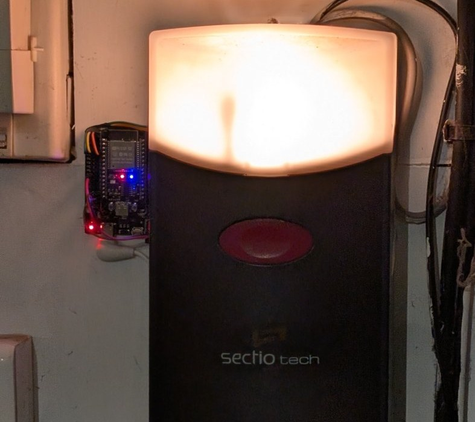</p>

<p align="center">


</p>

This repository is a **complete tutorial**: how to open and close a motorised garage door from a phone (Android or iPhone), over the home Wi-Fi, with an ESP32, a relay and a light sensor. Everything is explained step by step, with photos of the real assembly, diagrams and the commented code. The guides are in English; the app interface itself (screenshots, on-screen texts) is in French.

## The guides, in order

<table>
<tr><td align="center" valign="top" width="33%"><a href="docs/en/00-wiring-reference.md">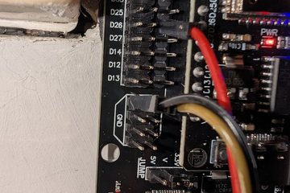<br><b>0. Wiring reference</b></a><br><sub>Wire colours, pins</sub></td><td align="center" valign="top" width="33%"><a href="docs/en/01-principle-and-choices.md">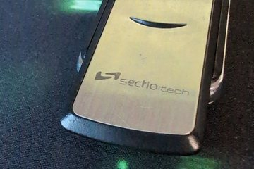<br><b>1. Principle and choices</b></a><br><sub>Why a relay</sub></td><td align="center" valign="top" width="33%"><a href="docs/en/02-parts.md">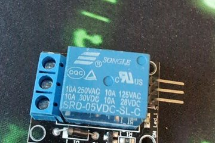<br><b>2. Parts</b></a><br><sub>Parts, prices, links</sub></td></tr>
<tr><td align="center" valign="top" width="33%"><a href="docs/en/03-control-unit-board.md">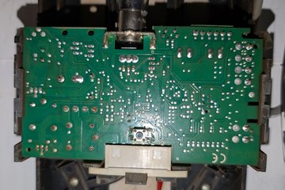<br><b>3. Board and button</b></a><br><sub>Finding legs C and D</sub></td><td align="center" valign="top" width="33%"><a href="docs/en/04-esp32-wiring.md">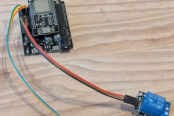<br><b>4. Wiring</b></a><br><sub>Relay and sensor on the board</sub></td><td align="center" valign="top" width="33%"><a href="docs/en/05-soldering-the-relay.md">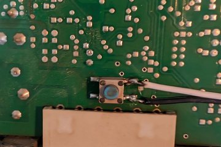<br><b>5. Relay</b></a><br><sub>Soldering and checks</sub></td></tr>
<tr><td align="center" valign="top" width="33%"><a href="docs/en/06-programming-the-esp32.md">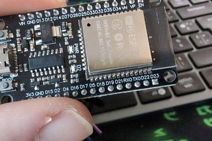<br><b>6. Programming</b></a><br><sub>Arduino IDE, upload, OTA</sub></td><td align="center" valign="top" width="33%"><a href="docs/en/07-first-start-and-use.md">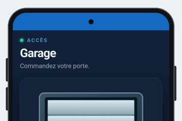<br><b>7. Use</b></a><br><sub>Wi-Fi, code, app</sub></td><td align="center" valign="top" width="33%"><a href="docs/en/08-https-home-network.md">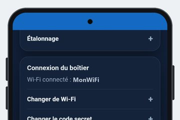<br><b>8. HTTPS</b></a><br><sub>App on Android</sub></td></tr>
<tr><td align="center" valign="top" width="33%"><a href="docs/en/09-manual-movement-detector.md">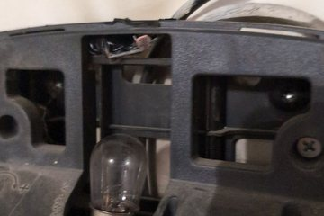<br><b>9. Light</b></a><br><sub>Manual movement detector</sub></td><td align="center" valign="top" width="33%"><a href="docs/en/10-installation.md">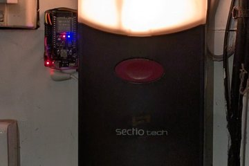<br><b>10. Installation</b></a><br><sub>What goes where</sub></td><td align="center" valign="top" width="33%"><a href="docs/en/11-security-and-limits.md">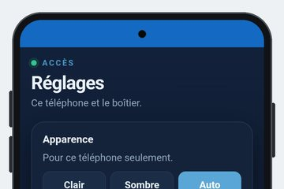<br><b>11. Security</b></a><br><sub>Protected / not protected</sub></td></tr>
<tr><td align="center" valign="top" width="33%"><a href="docs/en/12-troubleshooting.md">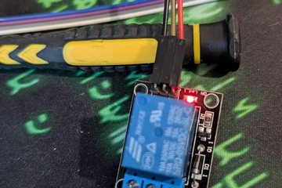<br><b>12. Troubleshooting</b></a><br><sub>Failures and fixes</sub></td><td align="center" valign="top" width="33%"><a href="docs/en/13-project-history.md">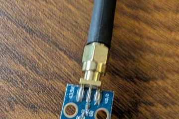<br><b>13. History</b></a><br><sub>Tests and choices</sub></td><td align="center" valign="top" width="33%"><a href="firmware/README.en.md">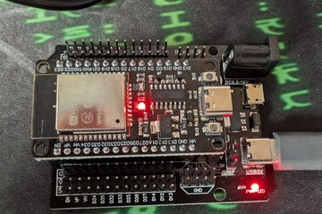<br><b>Code</b></a><br><sub>Files, routes, settings</sub></td></tr>
</table>

A demo page of the interface (example data) is in [`docs/demo/demo.html`](docs/demo/demo.html). GitHub only shows its code: to see it working, download the file (**Download raw file** button) then open it in a browser.

## Getting the project

- **No special tool needed**: on the repository page, green **Code** button, then **Download ZIP**. Unzip the archive; the program is in `firmware/porte_garage/`. Numbered versions can also be downloaded from the **Releases** tab.
- **With Git**:

```powershell
git clone https://github.com/jpparein/esp32-telecommande-porte-garage.git
```

The program is then compiled and uploaded to the ESP32 as described in [guide 6](docs/en/06-programming-the-esp32.md). No password has to be written in the code: the Wi-Fi and the secret code are set from the ESP32 configuration page.

## Installing the app on the phone

The "app" is a web page hosted in the ESP32: nothing to download from an app store. Once the ESP32 is on the home Wi-Fi ([guide 7](docs/en/07-first-start-and-use.md)):

- **iPhone (Safari)**: open `http://esp-acces.local` (or the IP address), tap **Share**, then **Add to Home Screen**.
- **Android (Chrome)**: full installation requires an HTTPS address ([guide 8](docs/en/08-https-home-network.md)); ⋮ menu, then **Install app**. Without HTTPS, only a shortcut is possible.

On first access, enter the secret code and a first name: the phone is then remembered.

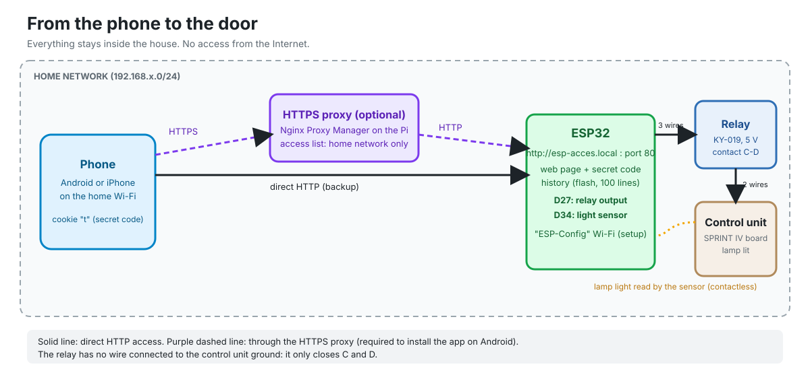

> **Wiring reference**: [wiring reference](docs/en/00-wiring-reference.md) (colour of each wire, module pin, board pin).

> **Why a relay rather than a copy of the remote?** Copying the original remote by radio was tested with a CC1101 module: it is impossible, because the remote uses a **rolling code** (HCS300 chip). The code changes at every press and cannot be replayed. The command therefore goes through a relay in parallel with the manual switch. See [project history](docs/en/13-project-history.md).

## What the project does

- A **web page hosted in the ESP32** (installable as an app on Android and iPhone) with an **Open** button and a **Close** button.
- A **secret code** and a **first name per phone**: the history says who gave each command.
- A **history of 100 events** kept in memory (even after a power cut), exportable as CSV.
- A **relay** wired in parallel with the control unit manual switch: it has exactly the same effect as a press.
- A **light sensor** placed next to the control unit lamp: if the door moves without an app command (manual switch or original remote), the history records "Mouvement manuel".
- A **simulation mode** to test everything without moving the door.
- A **wireless update** (OTA) and a **configuration page** (Wi-Fi, code) with no secret file to write in the code.
- **No access from the Internet**: the door can only be commanded from the home network.

## Who this tutorial is for

A beginner in electronics who can follow instructions. It requires soldering a thin wire, using a multimeter (voltage measurement and continuity test) and installing the Arduino IDE. Each step says what to check before moving on.

> **Warning: safety.** A door motorisation runs on 230 V. This assembly only touches the **low-voltage part** (the manual switch, about 5 V), **with the power off** for any soldering. **Never** bypass the motorisation's safety photocell. Read the [Security and limits](docs/en/11-security-and-limits.md) guide before starting.

## Quick start

1. Gather the parts ([guide 2](docs/en/02-parts.md)).
2. Wire the relay and the sensor to the ESP32 ([guide 4](docs/en/04-esp32-wiring.md)) and test **without the motorisation**.
3. Upload the program ([guide 6](docs/en/06-programming-the-esp32.md)), set the Wi-Fi and the code ([guide 7](docs/en/07-first-start-and-use.md)).
4. Test in **simulation mode**, then the relay alone (it must click).
5. Only then solder the relay to the button ([guide 5](docs/en/05-soldering-the-relay.md)) and install the assembly ([guide 10](docs/en/10-installation.md)).

## Hardware tested

- ESP32 (DevKit V1 module, 30 pins, USB-C, CH340 chip) on an expansion board with G/V/S rows.
- KY-019 relay (SRD-05VDC), KY-018 light sensor.
- Sectio-Tech sectional door motorisation (wall control unit, motor on the door), "SPRINT IV" electronic board (ref. 11515 Rev K). **The board may be different**: guide 3 explains how to find the button to double.

## Responsibility

This assembly acts on a motorised door: it is built and used under the user's sole responsibility. Before any use, check that the door stops properly on an obstacle (safety photocell). The documents in this repository are provided as is, without warranty.
