<h1 align="center">Commander sa porte de garage depuis un smartphone avec un ESP32</h1>

<p align="center">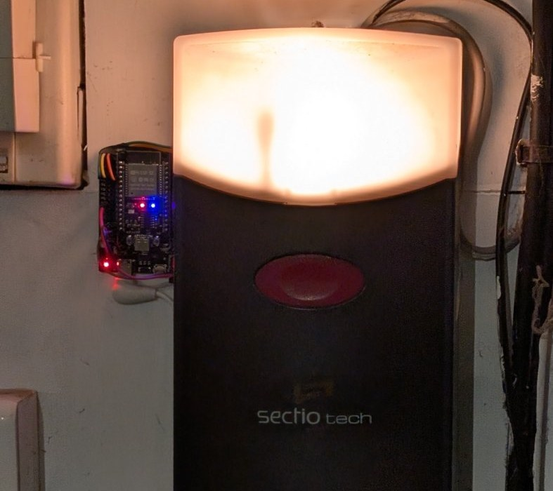</p>

<p align="center">


</p>

Ce dépôt est un **tutoriel complet** : comment ouvrir et fermer une porte de garage motorisée depuis un téléphone (Android ou iPhone), sur le Wi-Fi de la maison, avec un ESP32, un relais et un capteur de lumière. Tout est expliqué pas à pas, avec les photos du montage réel, des schémas et le code commenté.

## Les guides, dans l'ordre

<table>
<tr><td align="center" valign="top" width="33%"><a href="docs/00-fiche-de-cablage.md">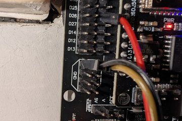<br><b>0. Fiche de câblage</b></a><br><sub>Couleurs des fils, broches</sub></td><td align="center" valign="top" width="33%"><a href="docs/01-principe-et-choix.md"><br><b>1. Principe et choix</b></a><br><sub>Pourquoi un relais</sub></td><td align="center" valign="top" width="33%"><a href="docs/02-materiel.md">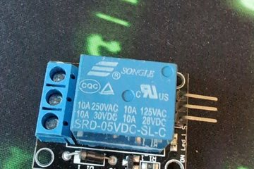<br><b>2. Matériel</b></a><br><sub>Pièces, prix, liens</sub></td></tr>
<tr><td align="center" valign="top" width="33%"><a href="docs/03-carte-moteur-et-bouton.md">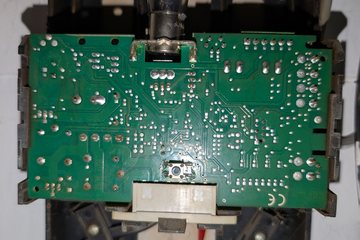<br><b>3. Carte et bouton</b></a><br><sub>Repérer les pattes C et D</sub></td><td align="center" valign="top" width="33%"><a href="docs/04-branchements-esp32.md">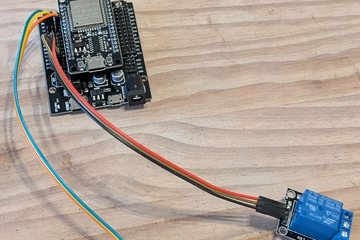<br><b>4. Branchements</b></a><br><sub>Relais et capteur sur la plaque</sub></td><td align="center" valign="top" width="33%"><a href="docs/05-souder-le-relais.md">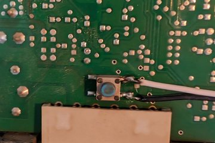<br><b>5. Relais</b></a><br><sub>Soudure et contrôles</sub></td></tr>
<tr><td align="center" valign="top" width="33%"><a href="docs/06-programmer-l-esp32.md">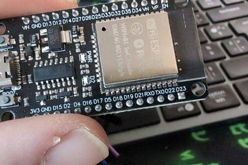<br><b>6. Programmer</b></a><br><sub>Arduino IDE, envoi, OTA</sub></td><td align="center" valign="top" width="33%"><a href="docs/07-premier-demarrage-et-utilisation.md">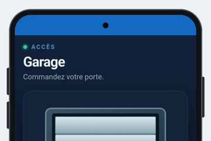<br><b>7. Utilisation</b></a><br><sub>Wi-Fi, code, appli</sub></td><td align="center" valign="top" width="33%"><a href="docs/08-https-reseau-maison.md">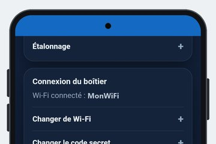<br><b>8. HTTPS</b></a><br><sub>Appli sur Android</sub></td></tr>
<tr><td align="center" valign="top" width="33%"><a href="docs/09-detecteur-mouvement-manuel.md">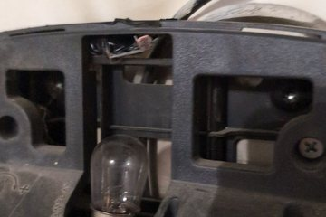<br><b>9. Lumière</b></a><br><sub>Détecteur de mouvement manuel</sub></td><td align="center" valign="top" width="33%"><a href="docs/10-installation-dans-le-boitier.md">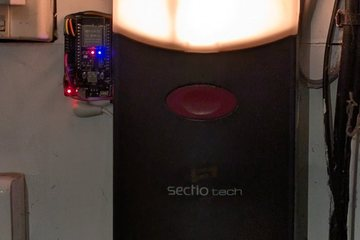<br><b>10. Installation</b></a><br><sub>Où poser quoi</sub></td><td align="center" valign="top" width="33%"><a href="docs/11-securite-et-limites.md">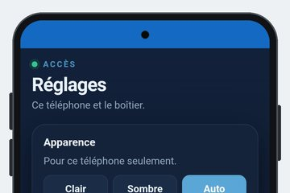<br><b>11. Sécurité</b></a><br><sub>Protégé / non protégé</sub></td></tr>
<tr><td align="center" valign="top" width="33%"><a href="docs/12-depannage.md">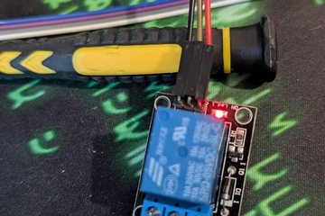<br><b>12. Dépannage</b></a><br><sub>Pannes et solutions</sub></td><td align="center" valign="top" width="33%"><a href="docs/13-histoire-du-projet.md">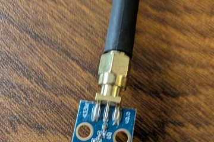<br><b>13. Histoire</b></a><br><sub>Essais et choix</sub></td><td align="center" valign="top" width="33%"><a href="firmware/README.md">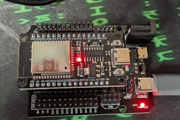<br><b>Code</b></a><br><sub>Fichiers, routes, réglages</sub></td></tr>
</table>

Une page de démonstration de l'interface (données d'exemple) est dans [`docs/demo/demo.html`](docs/demo/demo.html). GitHub n'en affiche que le code : pour la voir fonctionner, télécharger le fichier (bouton **Download raw file**) puis l'ouvrir dans un navigateur.

## Récupérer le projet

- **Sans outil particulier** : sur la page du dépôt, bouton vert **Code**, puis **Download ZIP**. Décompresser l'archive ; le programme est dans `firmware/porte_garage/`. Les versions numérotées sont aussi téléchargeables dans l'onglet **Releases**.
- **Avec Git** :

```powershell
git clone https://github.com/jpparein/esp32-telecommande-porte-garage.git
```

Le programme se compile et s'envoie ensuite à l'ESP32 comme indiqué dans le [guide 6](docs/06-programmer-l-esp32.md). Aucun mot de passe n'est à écrire dans le code : le Wi-Fi et le code secret se règlent depuis la page de configuration de l'ESP32.

## Installer l'application sur le téléphone

L'« application » est une page web hébergée dans l'ESP32 : rien à télécharger dans un magasin d'applications. Une fois l'ESP32 sur le Wi-Fi de la maison ([guide 7](docs/07-premier-demarrage-et-utilisation.md)) :

- **iPhone (Safari)** : ouvrir `http://esp-acces.local` (ou l'adresse IP), toucher **Partager**, puis **Sur l'écran d'accueil**.
- **Android (Chrome)** : l'installation complète exige une adresse HTTPS ([guide 8](docs/08-https-reseau-maison.md)) ; menu **⋮**, puis **Installer l'application**. Sans HTTPS, seul un raccourci est possible.

Au premier accès, saisir le code secret et un prénom : le téléphone est ensuite mémorisé.

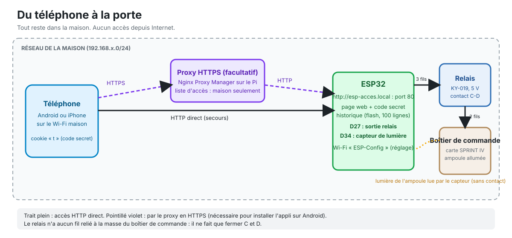

> **Référence de câblage** : [fiche de câblage](docs/00-fiche-de-cablage.md) (couleur de chaque fil, broche du module, broche de la plaque).

> **Pourquoi un relais plutôt qu'une copie de la télécommande ?** La copie radio de la télécommande d'origine a été testée avec un module CC1101 : elle est impossible, car la télécommande utilise un **code tournant** (rolling code, puce HCS300). Le code change à chaque appui et ne peut pas être rejoué. La commande passe donc par un relais en parallèle de l'interrupteur manuel. Voir [l'histoire du projet](docs/13-histoire-du-projet.md).

## Ce que fait le projet

- Une **page web hébergée dans l'ESP32** (installable comme une appli sur Android et sur iPhone) avec un gros bouton **Ouvrir** et un bouton **Fermer**.
- Un **code secret** et un **prénom par téléphone** : l'historique dit qui a donné chaque ordre.
- Un **historique de 100 évènements** gardé en mémoire (même après une coupure de courant), exportable en CSV.
- Un **relais** branché en parallèle du interrupteur manuel du boîtier de commande : il fait exactement le même effet qu'un appui.
- Un **capteur de lumière** posé près de l'ampoule du boîtier de commande : si la porte bouge sans ordre de l'appli (interrupteur manuel ou télécommande d'origine), l'historique note « Mouvement manuel ».
- Un **mode simulation** pour tout tester sans faire bouger la porte.
- Une **mise à jour sans câble** (OTA) et une **page de configuration** (Wi-Fi, code) sans fichier secret à écrire dans le code.
- **Aucun accès depuis Internet** : la porte ne se commande que depuis le réseau de la maison.

## À qui s'adresse ce tutoriel

À un débutant en électronique qui sait suivre une notice. Il faut savoir souder un fil fin, utiliser un multimètre (mesure de tension et test de continuité) et installer l'IDE Arduino. Chaque étape dit ce qu'il faut vérifier avant de passer à la suivante.

> **Attention : sécurité.** Une motorisation de porte est alimentée en 230 V. Ce montage ne touche **que la partie basse tension** (l'interrupteur manuel, environ 5 V), **courant coupé** pour toute soudure. Ne **jamais** contourner la cellule de sécurité de la motorisation. Lire le guide [Sécurité et limites](docs/11-securite-et-limites.md) avant de commencer.

## Démarrage rapide

1. Rassembler le matériel ([guide 2](docs/02-materiel.md)).
2. Brancher le relais et le capteur sur l'ESP32 ([guide 4](docs/04-branchements-esp32.md)) et tester **sans la motorisation**.
3. Envoyer le programme ([guide 6](docs/06-programmer-l-esp32.md)), configurer le Wi-Fi et le code ([guide 7](docs/07-premier-demarrage-et-utilisation.md)).
4. Tester en **mode simulation**, puis le relais seul (il doit cliquer).
5. Seulement ensuite, souder le relais sur le bouton ([guide 5](docs/05-souder-le-relais.md)) et installer l'ensemble ([guide 10](docs/10-installation-dans-le-boitier.md)).

## Matériel testé

- ESP32 (module DevKit V1 à 30 broches, USB-C, puce CH340) sur plaque d'extension à rangées G/V/S.
- Relais KY-019 (SRD-05VDC), capteur de lumière KY-018.
- Motorisation de porte sectionnelle de marque Sectio-Tech (boîtier de commande au mur, moteur sur la porte), carte électronique « SPRINT IV » (réf. 11515 Rev K). **La carte peut être différente** : le guide 3 explique comment trouver le bouton à doubler.

## Responsabilité

Ce montage agit sur une porte motorisée : il est réalisé et utilisé sous la seule responsabilité de l'utilisateur. Avant toute utilisation, vérifier que la porte s'arrête bien sur un obstacle (cellule de sécurité). Les documents de ce dépôt sont fournis tels quels, sans garantie.
