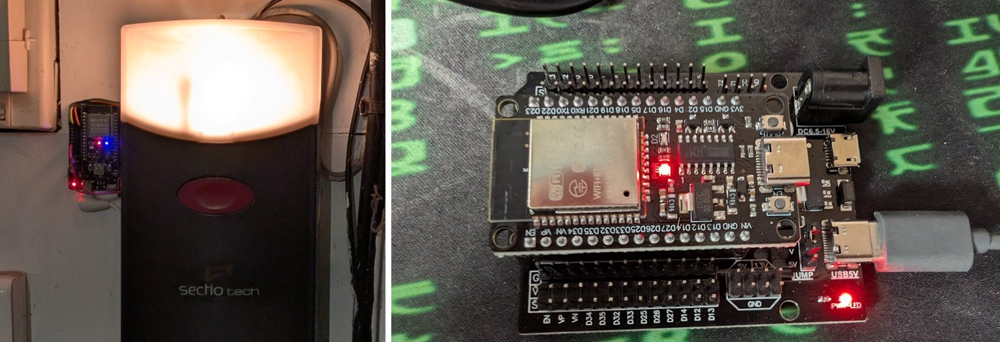

# Commander sa porte de garage depuis un smartphone avec un ESP32

Ce dépôt est un **tutoriel complet** : comment ouvrir et fermer une porte de garage motorisée depuis un téléphone (Android ou iPhone), sur le Wi-Fi de la maison, avec un ESP32, un relais et un capteur de lumière. Tout est expliqué pas à pas, avec les photos du montage réel, des schémas et le code commenté.

> **Référence de câblage** : [fiche de câblage](docs/00-fiche-de-cablage.md) (couleur de chaque fil, broche du module, broche de la plaque).

> **Pourquoi un relais plutôt qu'une copie de la télécommande ?** La copie radio de la télécommande d'origine a été testée avec un module CC1101 : elle est impossible, car la télécommande utilise un **code tournant** (rolling code, puce HCS300). Le code change à chaque appui et ne peut pas être rejoué. La commande passe donc par un relais en parallèle de l'interrupteur manuel. Voir [l'histoire du projet](docs/13-histoire-du-projet.md).

## Ce que fait le projet

- Une **page web hébergée dans l'ESP32** (installable comme une appli sur Android et sur iPhone) avec un gros bouton **Ouvrir** et un bouton **Fermer**.
- Un **code secret** et un **prénom par téléphone** : l'historique dit qui a donné chaque ordre.
- Un **historique de 100 évènements** gardé en mémoire (même après une coupure de courant), exportable en CSV.
- Un **relais** branché en parallèle du interrupteur manuel du boîtier de commande : il fait exactement le même effet qu'un appui.
- Un **capteur de lumière** posé près de l'ampoule du boîtier de commande : si la porte bouge sans ordre de l'appli (interrupteur manuel ou télécommande d'origine), l'historique note « Mouvement manuel ».
- Un **mode simulation** pour tout tester sans faire bouger la porte.
- Une **mise à jour sans câble** (OTA) et une **page de configuration** (Wi-Fi, code) sans fichier secret à écrire dans le code.
- **Aucun accès depuis Internet** : la porte ne se commande que depuis le réseau de la maison.

## À qui s'adresse ce tutoriel

À un débutant en électronique qui sait suivre une notice. Il faut savoir souder un fil fin, utiliser un multimètre (mesure de tension et test de continuité) et installer l'IDE Arduino. Chaque étape dit ce qu'il faut vérifier avant de passer à la suivante.

> **Attention : sécurité.** Une motorisation de porte est alimentée en 230 V. Ce montage ne touche **que la partie basse tension** (l'interrupteur manuel, environ 5 V), **courant coupé** pour toute soudure. Ne **jamais** contourner la cellule de sécurité de la motorisation. Lire le guide [Sécurité et limites](docs/11-securite-et-limites.md) avant de commencer.

## Les guides, dans l'ordre

| # | Guide | Contenu |
|---|---|---|
| 1 | [Principe et choix](docs/01-principe-et-choix.md) | Pourquoi un relais plutôt que copier la télécommande radio |
| 2 | [Matériel](docs/02-materiel.md) | Liste des pièces, photos, prix réels |
| 3 | [La carte du boîtier de commande et son interrupteur manuel](docs/03-carte-moteur-et-bouton.md) | Repérer les bonnes pattes, mesures, précautions |
| 4 | [Branchements de l'ESP32](docs/04-branchements-esp32.md) | Relais et capteur sur la plaque d'extension |
| 5 | [Souder le relais sur le bouton](docs/05-souder-le-relais.md) | Soudure, contrôles au multimètre |
| 6 | [Programmer l'ESP32](docs/06-programmer-l-esp32.md) | Arduino IDE, compilation, premier envoi, mises à jour sans câble |
| 7 | [Premier démarrage et utilisation](docs/07-premier-demarrage-et-utilisation.md) | Wi-Fi, code secret, installer l'appli, simulation |
| 8 | [HTTPS réseau maison](docs/08-https-reseau-maison.md) | Installer l'appli sur Android, sans ouvrir la porte à Internet |
| 9 | [Détecteur de mouvement manuel](docs/09-detecteur-mouvement-manuel.md) | Capteur de lumière et étalonnage |
| 10 | [Installation dans le boîtier](docs/10-installation-dans-le-boitier.md) | Où poser quoi, en sécurité |
| 11 | [Sécurité et limites](docs/11-securite-et-limites.md) | Ce qui est protégé, ce qui ne l'est pas |
| 12 | [Dépannage](docs/12-depannage.md) | Les pièges rencontrés et leurs solutions |
| 13 | [Histoire du projet](docs/13-histoire-du-projet.md) | Les essais, les erreurs, les choix |

Le code est dans [`firmware/`](firmware/README.md). Une page de démonstration de l'interface (données d'exemple) est dans [`docs/demo/demo.html`](docs/demo/demo.html) : à ouvrir dans un navigateur.

## Démarrage rapide

1. Rassembler le matériel ([guide 2](docs/02-materiel.md)).
2. Brancher le relais et le capteur sur l'ESP32 ([guide 4](docs/04-branchements-esp32.md)) et tester **sans la motorisation**.
3. Envoyer le programme ([guide 6](docs/06-programmer-l-esp32.md)), configurer le Wi-Fi et le code ([guide 7](docs/07-premier-demarrage-et-utilisation.md)).
4. Tester en **mode simulation**, puis le relais seul (il doit cliquer).
5. Seulement ensuite, souder le relais sur le bouton ([guide 5](docs/05-souder-le-relais.md)) et installer l'ensemble ([guide 10](docs/10-installation-dans-le-boitier.md)).

## Matériel testé

- ESP32 (module DevKit V1 à 30 broches, USB-C, puce CH340) sur plaque d'extension à rangées G/V/S.
- Relais KY-019 (SRD-05VDC), capteur de lumière KY-018.
- Motorisation de porte sectionnelle de marque Sectio-Tech (boîtier de commande au mur, moteur sur la porte), carte électronique « SPRINT IV » (réf. 11515 Rev K). **La carte peut être différente** : le guide 3 explique comment trouver le bouton à doubler.

## Responsabilité

Ce montage agit sur une porte motorisée : il est réalisé et utilisé sous la seule responsabilité de l'utilisateur. Avant toute utilisation, vérifier que la porte s'arrête bien sur un obstacle (cellule de sécurité). Les documents de ce dépôt sont fournis tels quels, sans garantie.
