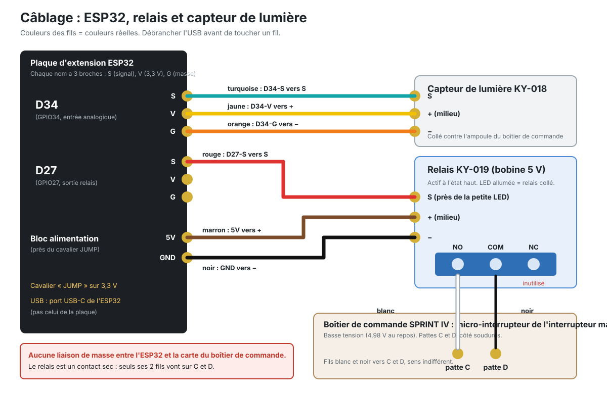
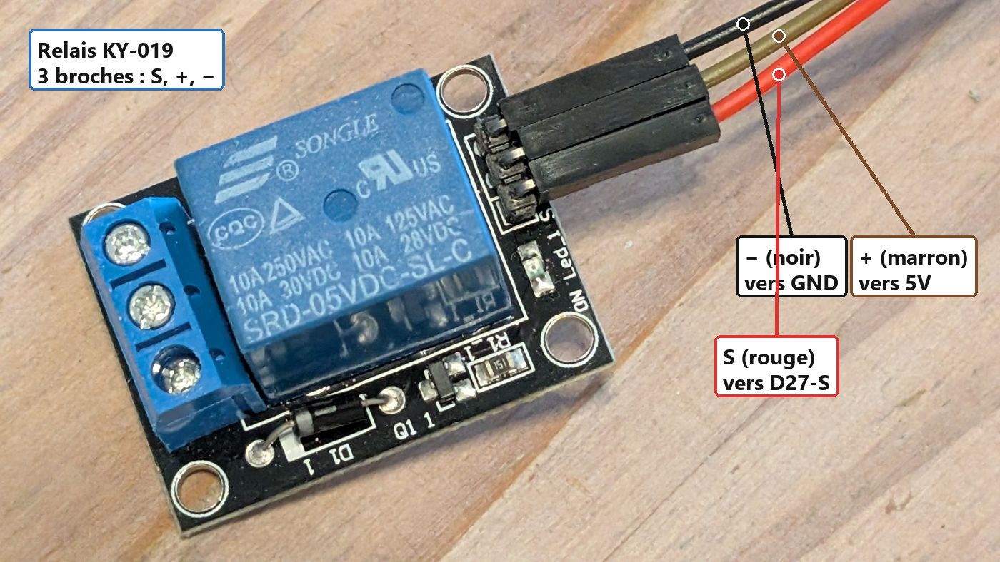
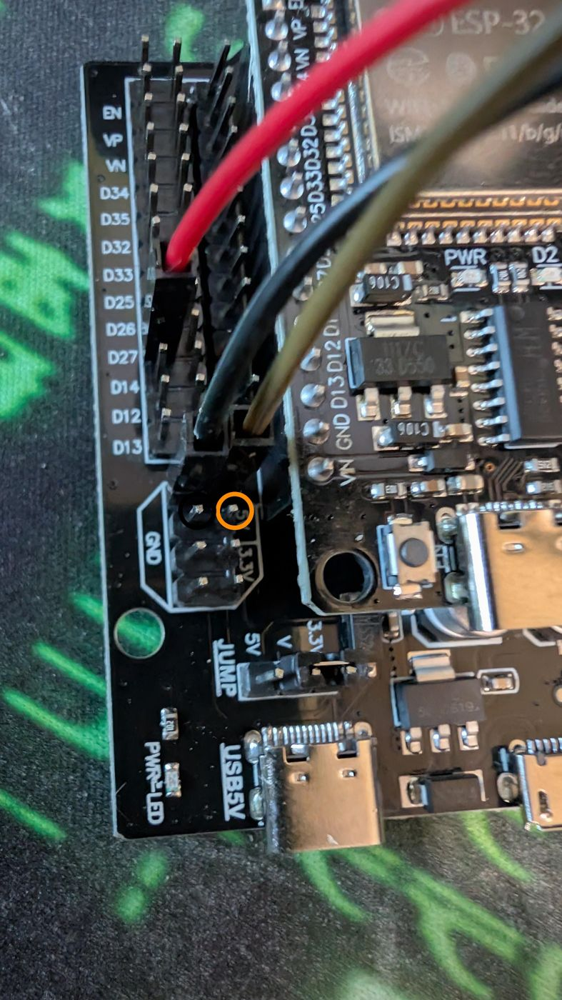
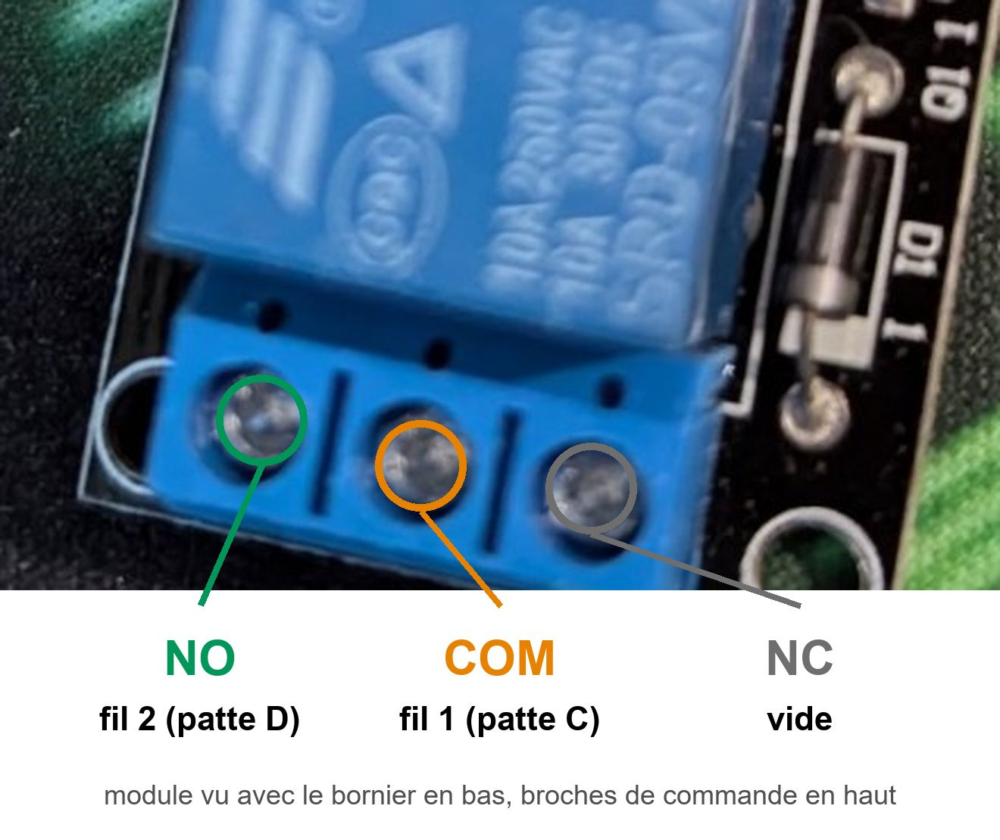
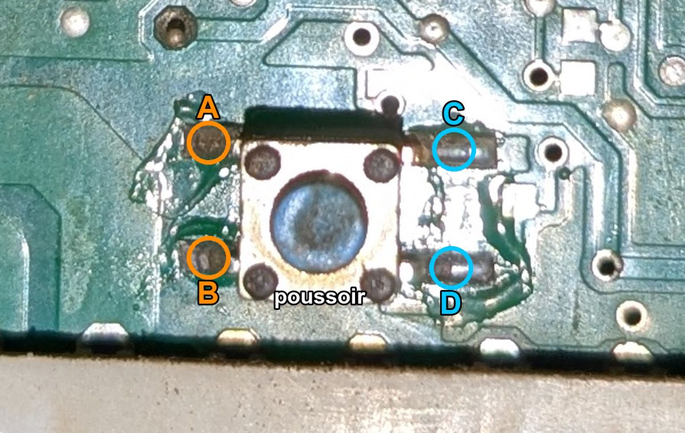
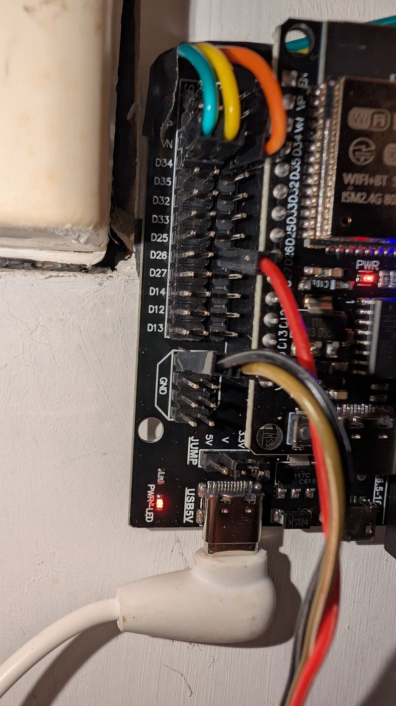

# Fiche de câblage

Référence de câblage de l'ensemble : couleurs des fils, broches des modules, broches de la plaque. **Débrancher l'ESP32 de l'USB avant toute intervention sur un fil.**

Convention de la plaque d'extension : chaque nom imprimé (D27, D34…) correspond à **3 broches** en ligne : **S** (signal, côté du nom), **V** (milieu, 3,3 V avec le cavalier), **G** (masse).

## 1. Relais KY-019 (commande de la porte)

Connecteur Dupont 3 fils sur le relais. Sur la carte du relais, les broches portent les repères **S**, **+**, **−** (le **S** est le plus proche de la petite LED `Led_1`).

| Fil | Broche du relais | Va sur la plaque ESP32 | Pourquoi |
|---|---|---|---|
| **Rouge** | **S** (signal) | colonne **D27**, rangée **S** | D27 est la sortie qui commande le relais (état haut = relais collé) |
| **Marron** | **+** (milieu) | bloc 5V / GND (près du cavalier JUMP), broche **5V** | la bobine du relais exige 5 V ; la rangée V ne fournit que 3,3 V |
| **Noir** | **−** | bloc 5V / GND (près du cavalier JUMP), broche **GND** | retour de masse commun avec l'ESP32 |

Contacts du relais (bornier bleu à vis) : **COM** (vis du milieu) et **NO** (vis de gauche). **NC (droite) : inutilisée.**

Ces deux vis sont reliées par 2 fils aux pattes **C** et **D** du micro-interrupteur de l'interrupteur manuel, sur la carte du boîtier de commande (sens indifférent) :

| Fil | Vis du relais | Patte de la carte du boîtier |
|---|---|---|
| **Blanc** | NO ou COM | C ou D |
| **Noir** | l'autre vis | l'autre patte |

Pourquoi NO et COM : le contact est **ouvert au repos** et ne se ferme que lorsque le relais colle, comme l'interrupteur manuel. Avec NC, la porte serait commandée en permanence, sauf pendant l'impulsion. Les pattes C et D sont celles qui se ferment à l'appui sur le bouton (guide 3).

## 2. Capteur de lumière KY-018

Connecteur Dupont 3 fils sur le capteur. Sur la carte du capteur, les broches sont, de gauche à droite (côté soudures, texte « S » en haut à gauche) : **S**, **milieu (+)**, **−**.

| Fil | Broche du capteur | Va sur la plaque ESP32 | Pourquoi |
|---|---|---|---|
| **Turquoise** | **S** (signal) | colonne **D34**, rangée **S** | D34 est une entrée analogique (ADC1), utilisable avec le Wi-Fi actif |
| **Jaune** | **+** (milieu) | colonne **D34**, rangée **V** (3,3 V) | le capteur est alimenté en 3,3 V pour rester dans la plage de lecture de l'ESP32 |
| **Orange** | **−** | colonne **D34**, rangée **G** | masse du capteur |

Le capteur est sur **D34** (GPIO34, entrée analogique). La rangée juste au-dessus s'appelle **VN** : **ce n'est pas la bonne**, le programme ne lit pas VN.

## 3. Alimentation

Câble USB blanc (chargeur 5 V) dans le **port USB-C de l'ESP32** (pas celui de la plaque). Cavalier de la plaque sur **3,3 V**.

## 4. Contrôles après une modification du câblage

1. La LED rouge **PWR** de la plaque est allumée.
2. Dans l'appli, Réglages : la mesure du capteur varie à l'éclairage.
3. Bouton **Ouvrir** en **mode simulation désactivé** : le relais clique et sa LED s'allume 1 seconde.
4. Sans clic ni LED : mesure 5 V entre le fil marron et le fil noir du relais (4,6 à 5 V attendus).

## 5. À ne jamais faire

- Ne **jamais** relier la masse de l'ESP32 à celle de la carte du boîtier de commande.
- Ne pas mettre le fil **marron** du relais sur V (3,3 V) : le relais ne colle pas.
- Ne rien souder sur les pattes **A** et **B** du micro-interrupteur.
- Ne toucher à rien côté 230 V (cosses du transformateur) sans avoir coupé le disjoncteur.
