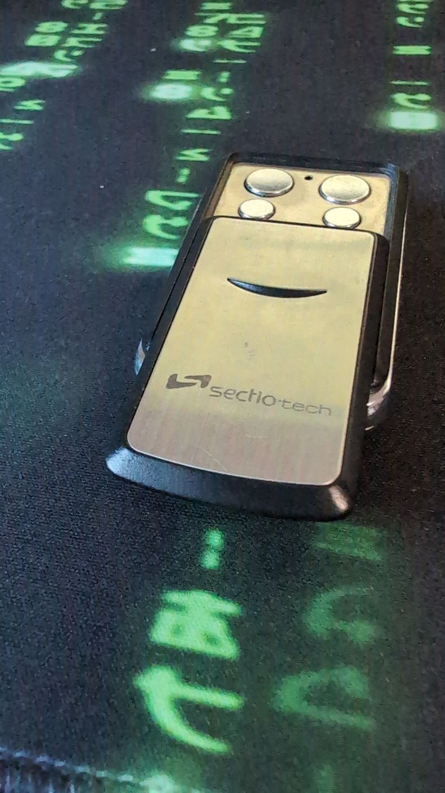
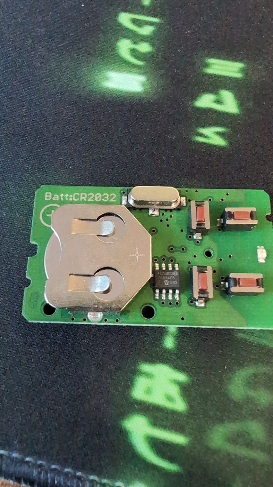
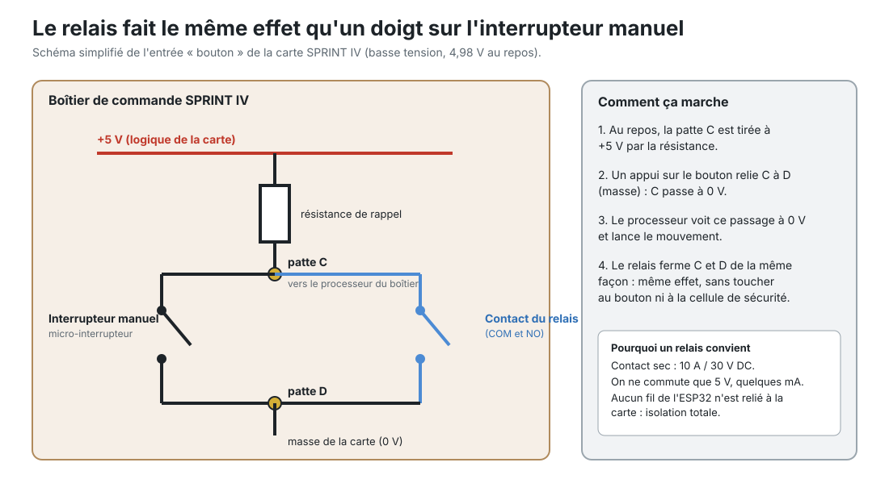
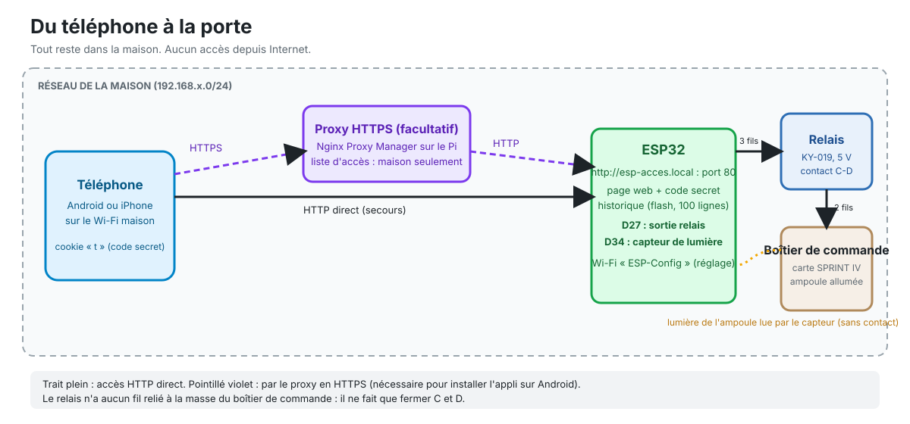

# 1. Principe et choix

[English version](en/01-principle-and-choices.md)

## Le but

Ouvrir et fermer la porte de garage **depuis un smartphone en arrivant en voiture**, sur le Wi-Fi de la maison. Un téléphone Android et un iPhone (avec CarPlay filaire) doivent pouvoir le faire.

Contraintes retenues dès le départ :

- **Pas de Bluetooth.** Safari sur iPhone ne permet pas le Bluetooth Web : une page web est la seule solution qui marche sur les deux systèmes sans installer d'application depuis un magasin.
- **Pas d'accès direct depuis Internet.** Une porte de garage ne doit pas être joignable de l'extérieur. Si l'ouverture à distance devient nécessaire, passer par un VPN.
- **Le Wi-Fi du téléphone doit se connecter en quelques secondes** quand la voiture arrive dans l'allée.

## Première idée : copier la télécommande radio (abandonnée)

La télécommande d'origine (4 boutons, pile CR2032) émet sur 433,92 MHz. L'idée : la copier avec un module radio **CC1101** branché sur l'ESP32.

À l'ouverture de la télécommande, la carte porte une puce **HCS300** (Microchip), un encodeur **KeeLoq à code tournant** : à chaque appui, le code change. Copier un appui ne sert alors à rien, la motorisation refuserait le code rejoué.

Pour le vérifier : appuyer trois fois sur le même bouton et comparer les trois émissions. Identiques = code fixe (le rejeu marche). Différents = code tournant (le rejeu échoue). Ici : code tournant, donc **copie radio impossible**.

Le module CC1101 a quand même servi à des essais (voir [Histoire du projet](13-histoire-du-projet.md)) mais il n'est **plus utilisé**.

## Deuxième idée : un relais sur le bouton du boîtier de commande (retenue)

Le boîtier de commande a un **gros interrupteur manuel** rouge sur son capot. Il appuie sur un micro-interrupteur de la carte électronique. Un **relais en parallèle** de ce micro-interrupteur, l'ESP32 peut « appuyer » à la place du doigt.

Avantages :

- Aucune modification de la motorisation, juste deux fils soudés sur les pattes du micro-interrupteur.
- Le **interrupteur manuel d'origine et la télécommande d'origine continuent de marcher**.
- La **cellule de sécurité** de la motorisation reste active : le relais ne fait que doubler un appui.

## Ce que le relais ne dit pas

La motorisation ne renvoie aucune information sur la position de la porte. Le relais envoie la **même impulsion** pour ouvrir et pour fermer : c'est la motorisation qui décide du sens (ouvrir si la porte est fermée, et inversement). L'appli note donc la dernière demande, mais **ne connaît pas la position réelle**.

Pour savoir si la porte a bougé sans passer par l'appli, un **capteur de lumière** est ajouté près de l'ampoule du boîtier de commande (guide 9). Un capteur de position (infrarouge, aimant) reste une amélioration possible.

## Architecture

L'ESP32 héberge une petite page web. Le téléphone s'y connecte par le Wi-Fi de la maison. Facultatif : un proxy HTTPS (guide 8) devant l'ESP32, restreint au réseau de la maison, permet d'installer l'appli sur Android.
