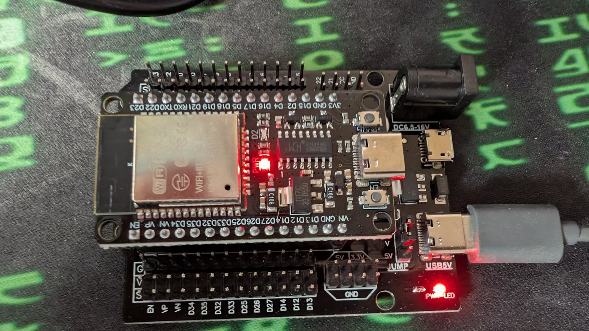
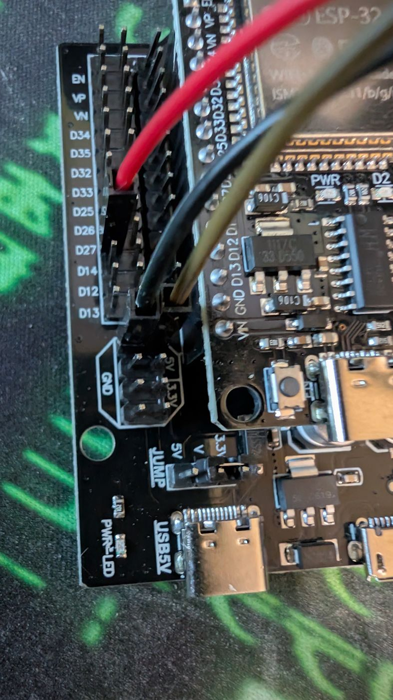
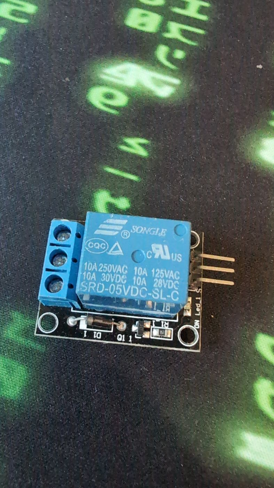
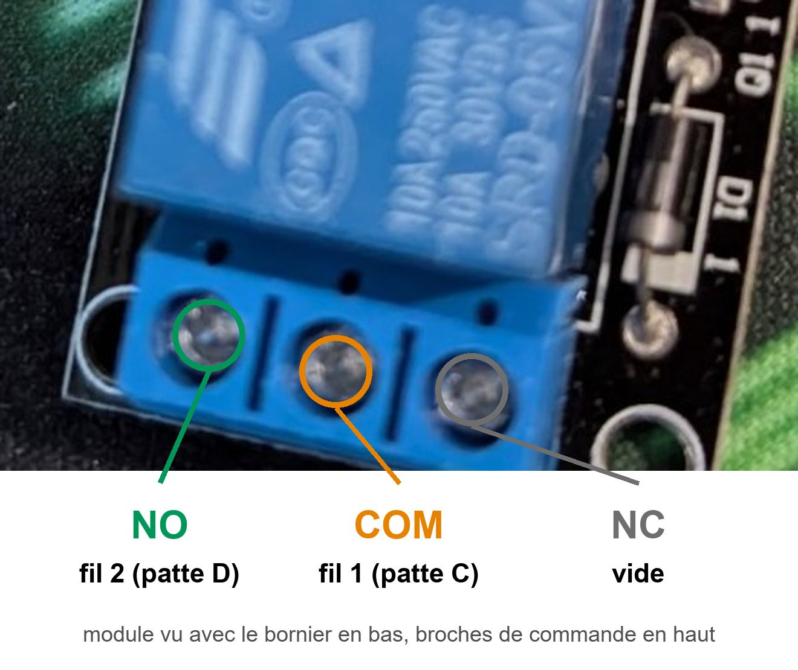
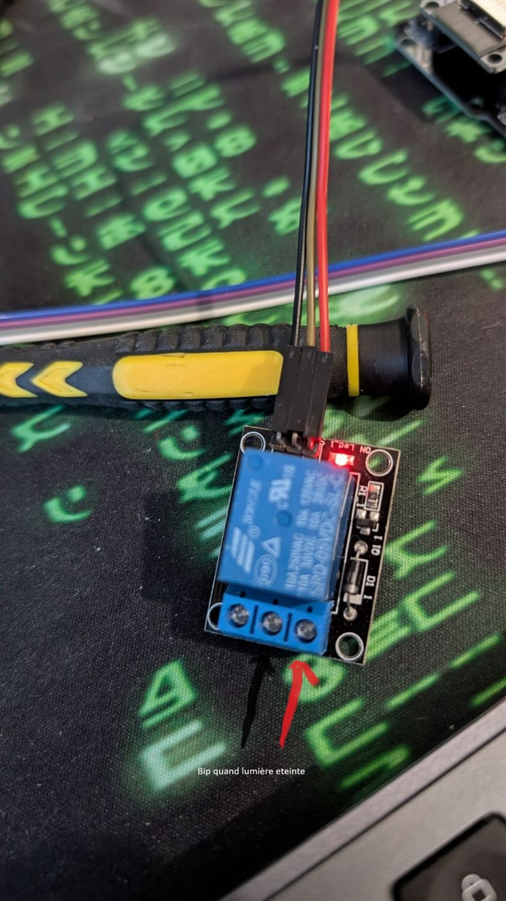
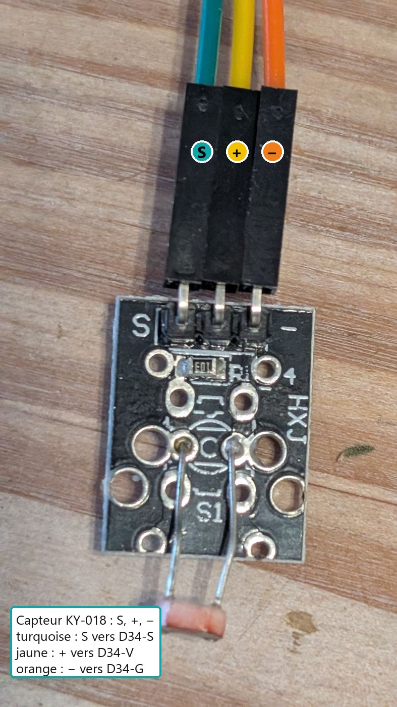

# 2. Matériel

[English version](en/02-parts.md)

## Liste des pièces

| Pièce | Rôle | Remarque |
|---|---|---|
| **ESP32** (DevKit V1, 30 broches, ESP32-WROOM-32, USB-C, puce USB-série CH340) | Cerveau : Wi-Fi, page web, relais, capteur | Port USB-C pour la programmation |
| **Plaque d'extension** à rangées G / V / S | Brancher les modules sans soudure | Avec cavalier de tension (3,3 V / 5 V) |
| **Relais KY-019** (SRD-05VDC) | Actionne l'interrupteur manuel du boîtier de commande | Bobine 5 V, actif à l'état haut, contacts 10 A / 30 V DC |
| **Capteur de lumière KY-018** | Voir l'ampoule du boîtier de commande s'allumer | Photorésistance sur petite carte à 3 broches |
| Fils **Dupont** femelle-femelle | Relier les modules à la plaque | Une quinzaine |
| Fil fin (environ 0,5 mm²) | Relais vers l'interrupteur manuel du boîtier | 2 fils, 20 à 50 cm |
| **Chargeur USB** 5 V (1 A) et câble USB-C | Alimenter l'ESP32 | Sur une prise proche |
| **Multimètre** | Contrôles | Tension continue et continuité |
| Fer à souder fin + étain | Souder sur la carte | |
| Chatterton, double-face, colliers | Fixer et isoler | Le double-face doit être isolant |

## Coût des pièces

> **Coût du montage à l'unité** (prix Amazon.fr relevés le 22/11/2026, offre la moins chère de chaque pièce, hors livraison). L'ensemble ESP32 + plaque est le kit réellement acheté : **lot de 2 ensembles à 15,99 €** (prix affiché sur la fiche), soit **8,00 € l'unité**.

| Pièce | Offre retenue (Amazon.fr) | Prix du lot | Coût à l'unité | Quantité utilisée | Coût dans le montage |
|---|---|---|---|---|---|
| ESP32 DevKit V1 30 broches + plaque d'extension G / V / S | [Binghe, lot de 2 ensembles (acheté)](https://amzn.eu/d/0a67U5Ma) | 15,99 € | 8,00 € | 1 | **8,00 €** |
| Relais KY-019 | [Lot de 3 modules KY-019](https://www.amazon.fr/dp/B0D8Q5NKF9) | 5,88 € | 1,96 € | 1 | **1,96 €** |
| Capteur de lumière KY-018 | [Lot de 4 modules KY-018](https://www.amazon.fr/dp/B0D846R9XM) | 15,59 € | 3,90 € | 1 | **3,90 €** |
| Fils Dupont | [Lot de 120 câbles, 10 cm](https://www.amazon.fr/dp/B0DQ4W15L9) | 7,99 € | 0,07 € | 6 | **0,40 €** |
| Fil fin, chatterton, double-face | Récupération | | | | 0,00 € |
| Chargeur USB 5 V et câble USB-C | Récupération | | | | 0,00 € |
| **Total du montage** | | | | | **≈ 14,26 €** |

Achat minimal si aucune pièce n'est disponible (un lot de chaque, kit ESP32 compris) : 15,99 + 5,88 + 15,59 + 7,99 = 45,45 €. Les prix Amazon varient : à revérifier sur les liens avant achat. Les modules « photorésistance numérique » (DollaTek, sortie DO/AO sur LM393) ne sont **pas** équivalents : le KY-018 a 3 broches (S, +, -) et une sortie analogique seule.

À comparer avec une télécommande d'origine de remplacement ou un module Wi-Fi du commerce, qui ne se branchent pas toujours sur cette motorisation.

Pour la configuration optionnelle (HTTPS, guide 8) : un petit serveur sur le réseau (ici un Raspberry Pi avec Nginx Proxy Manager) et un nom de domaine gratuit (DuckDNS).

## Photos des pièces

### ESP32 sur sa plaque

La plaque a **trois rangées** de broches pour chaque borne de l'ESP32 : **S** (signal, rangée la plus proche du nom imprimé), **V** (tension) et **G** (masse). Un **cavalier** (JUMP) choisit la tension de la rangée V : 3,3 V ou 5 V. Il reste sur **3,3 V** ici.

Le petit **bloc de broches repéré 5V / 3.3V / GND**, près du cavalier JUMP, donne le **5 V** et le **GND** (masse) : c'est là que se branche l'alimentation du relais.

### Relais KY-019

- Côté commande (3 broches) : **S** (signal), **+** (milieu), **−**.
- Côté puissance (bornier à vis) : **NO** (normalement ouvert), **COM** (commun), **NC** (normalement fermé). Seuls **COM** et **NO** sont utilisés.

Le bornier se repère au multimètre en mode continuité : COM et NO ne sont reliés que quand le relais est collé.

### Capteur de lumière KY-018

3 broches : **S** (sortie analogique), **+** (alimentation 3,3 V), **−** (masse). Plus il y a de lumière, plus la valeur lue est **basse**.

## Éléments non utilisés

- Le module radio **CC1101** : voir [Histoire du projet](13-histoire-du-projet.md).
- Un capteur de position (module infrarouge, interrupteur reed, ultrason) : pas installé.
