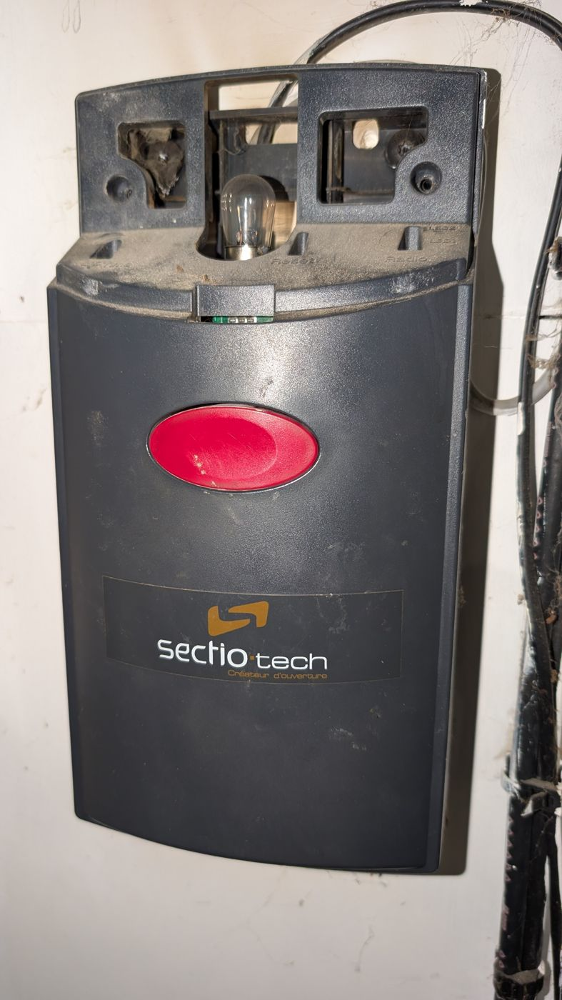
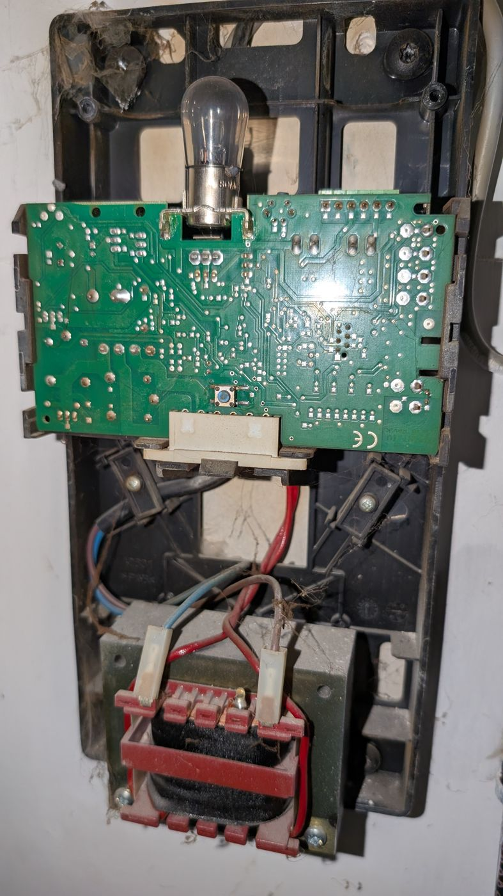
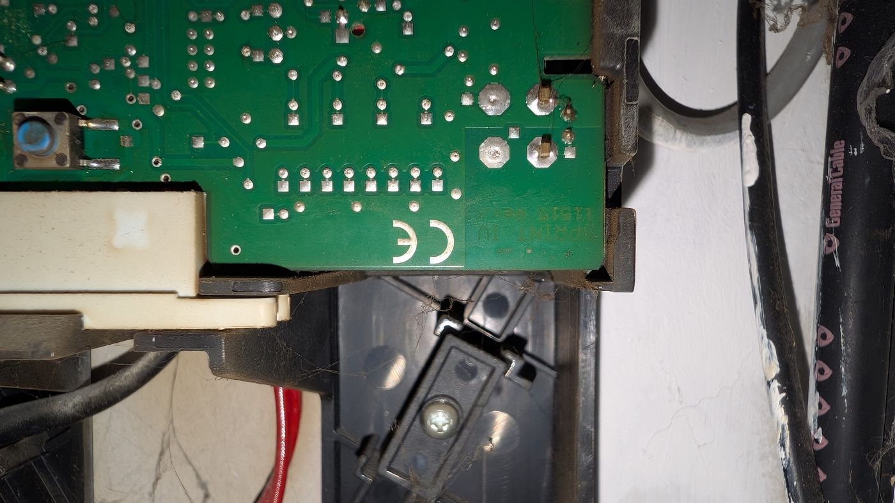
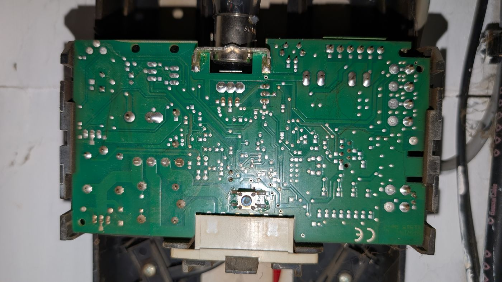
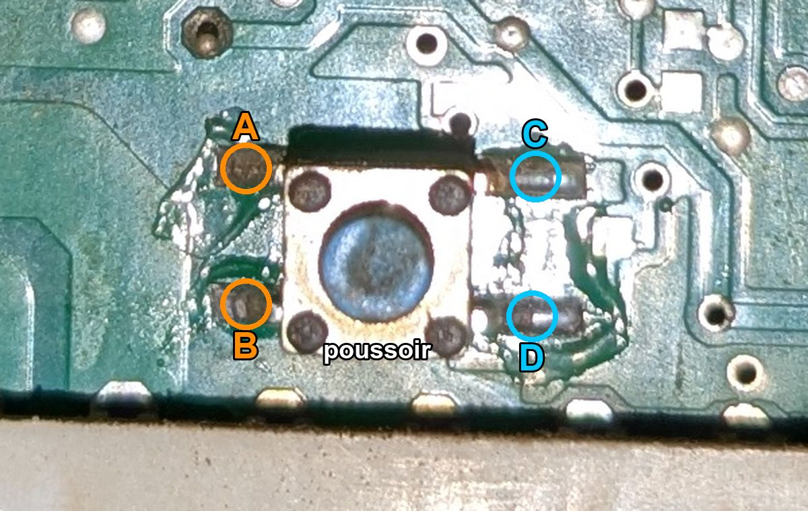

# 3. La carte du boîtier de commande et son interrupteur manuel

[English version](en/03-control-unit-board.md)

> **Danger.** Le boîtier de commande contient du **230 V** (cosses du transformateur, partie secteur de la carte). **Couper le courant** (disjoncteur) avant d'ouvrir le boîtier et pour toute soudure. Seules les deux pattes du micro-interrupteur sont à toucher : elles sont en basse tension.

## Le boîtier

Le boîtier de commande, fixé au mur, est de marque **Sectio-Tech** (le moteur lui-même est sur la porte). Son capot porte l'**interrupteur manuel** rouge, l'**ampoule d'éclairage** (dans une fente en haut) et des petits boutons de réglage (Time, Reset, Radio).

Une fois le capot retiré : la carte électronique est en haut, le **transformateur** en bas.

## La carte électronique

La carte porte l'inscription **SPRINT IV** et la référence **11515 Rev K**. Aucune documentation du constructeur n'a été trouvée : les informations proviennent de mesures.

L'interrupteur manuel **appuie sur un micro-interrupteur** monté sur la carte. Voici ce micro-interrupteur vu côté soudures :

## Trouver les deux bonnes pattes

Un micro-interrupteur a 4 pattes, reliées deux par deux. Il faut trouver la **paire qui se ferme à l'appui**.

1. **Courant coupé**, multimètre en **continuité** (bip).
2. Toucher deux pattes avec les pointes et enfoncer le bouton avec un tournevis isolé, ou en actionnant le bouton depuis le capot (carte déposée si nécessaire).
3. Noter les deux pattes qui **bipent seulement quand le bouton est enfoncé**.

Sur cette carte, ce sont **C** et **D**. Ce sont les deux pattes à doubler avec le relais.

## Mesure de tension au repos

**Courant remis, avec grande prudence** (seules les deux pointes du multimètre sont posées sur les deux pattes, sans appuyer) :

- Mesure relevée : **4,98 V continu** entre C et D au repos.

Interprétation : une patte est à environ 5 V (résistance de rappel), l'autre est à la masse de la carte. Un appui relie les deux. C'est une **entrée de bouton en basse tension**.

Le **contact sec du relais** (10 A / 30 V DC) est très supérieur au besoin (5 V, quelques mA) : il ferme C et D, comme le bouton.

Couper ensuite le courant.

## À ne pas faire

- **Ne jamais relier la masse de l'ESP32 à la masse de la carte du boîtier de commande** : l'isolation de cette carte par rapport au secteur n'est pas connue. Le relais, lui, est un contact sec isolé : aucun fil de l'ESP32 n'est relié à la carte.
- **Ne pas contourner la cellule de sécurité** de la motorisation.
- Ne pas souder sur les pattes A et B : elles ne font pas partie du bouton.

Passer ensuite au [guide 4](04-branchements-esp32.md) pour brancher l'ESP32 et le relais **avant** de souder quoi que ce soit sur la carte.
