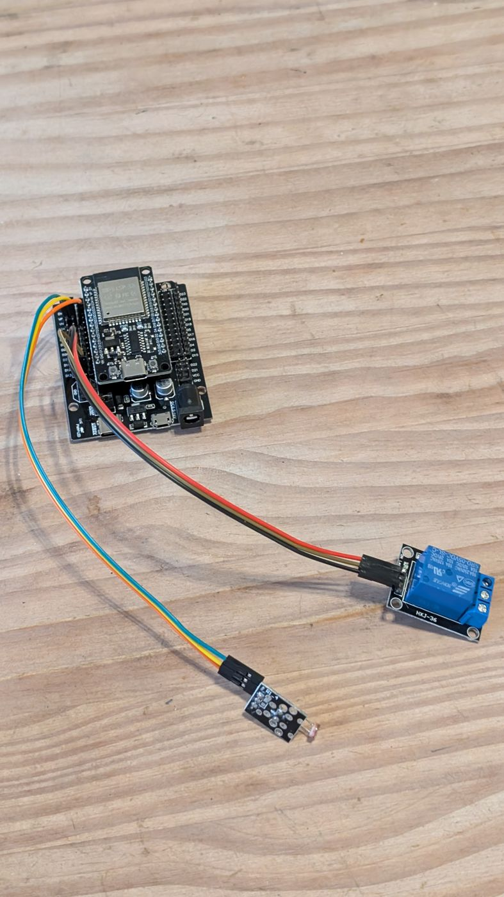
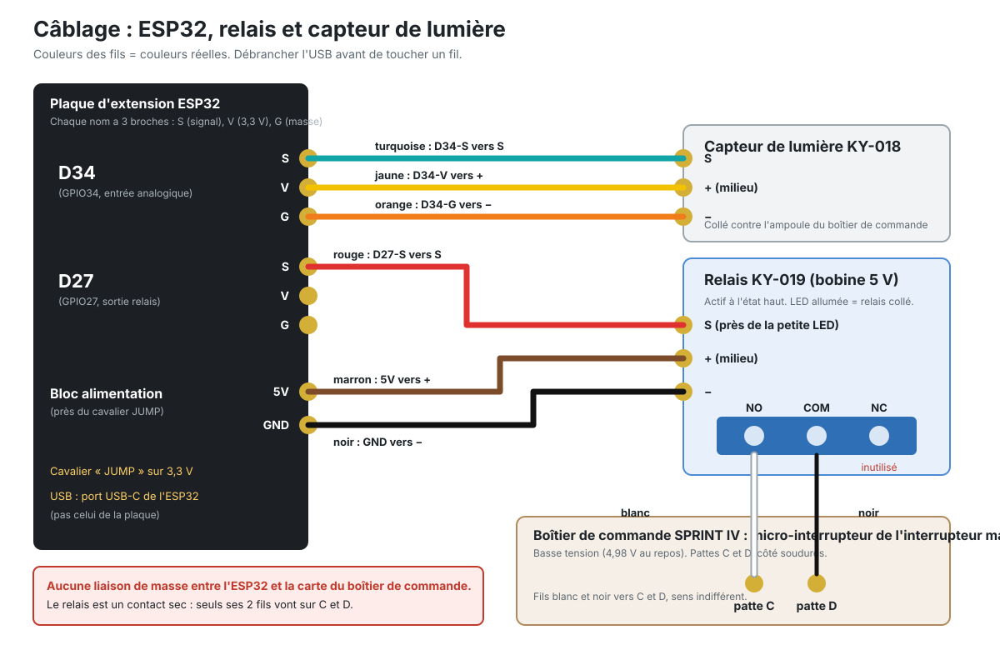
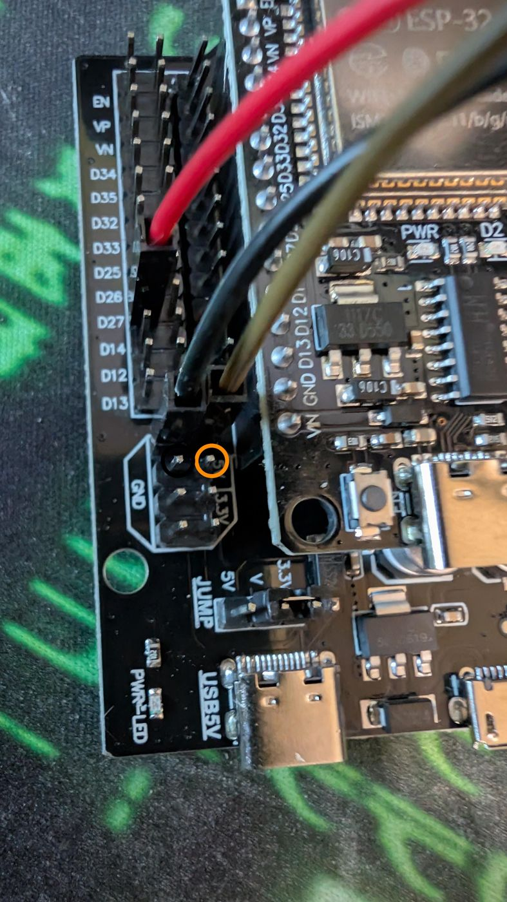
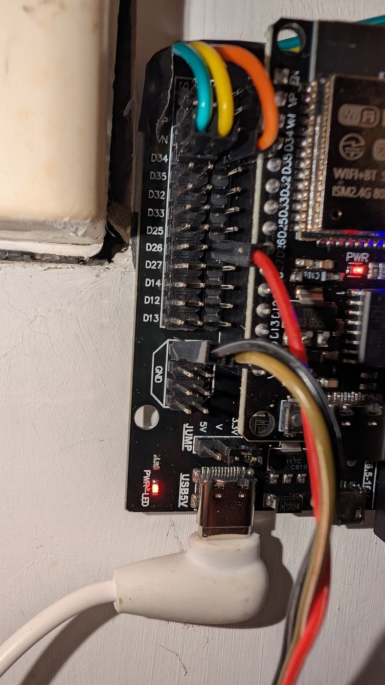
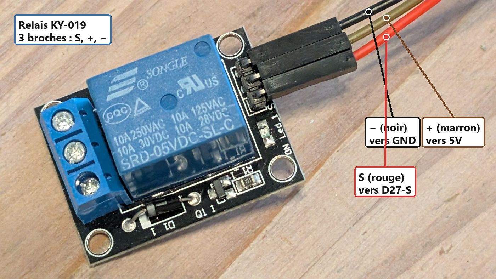
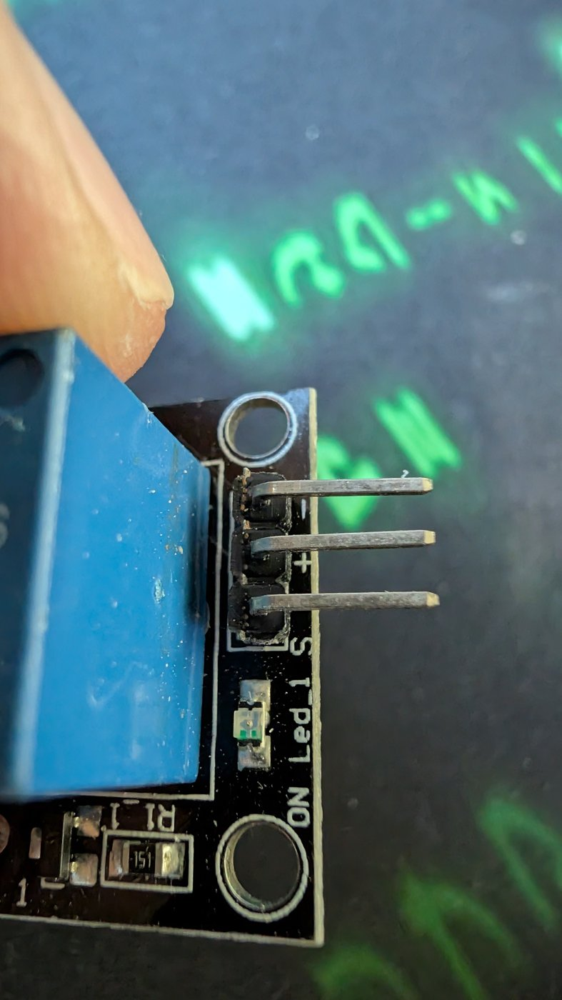

# 4. Branchements de l'ESP32

[English version](en/04-esp32-wiring.md)

Le montage se réalise d'abord **hors installation** (en banc d'essai), sans toucher à la motorisation. Le relais, ses contacts « libres » et le capteur se testent très bien seuls.

Référence rapide : [fiche de câblage](00-fiche-de-cablage.md) (couleurs des fils).

Débrancher l'ESP32 de l'USB **à chaque déplacement d'un fil**.

## Tableau des branchements

| Module | Broche du module | Va sur la plaque ESP32 |
|---|---|---|
| **Relais KY-019** | **S** (signal) | colonne **D27**, rangée **S** |
| Relais KY-019 | **+** (milieu) | bloc 5V / GND (près du cavalier JUMP), broche **5V** |
| Relais KY-019 | **−** | bloc 5V / GND (près du cavalier JUMP), broche **GND** |
| **Capteur KY-018** | **S** | colonne **D34**, rangée **S** |
| Capteur KY-018 | **+** (milieu) | colonne **D34**, rangée **V** (3,3 V) |
| Capteur KY-018 | **−** | colonne **D34**, rangée **G** |

## Comment lire la plaque

Chaque broche de l'ESP32 (D27, D34, …) a **3 broches en ligne** sur la plaque :

- **S** : le signal, **côté du nom imprimé** ;
- **V** : le milieu, la tension choisie par le cavalier (3,3 V ici) ;
- **G** : la masse.

Le nom (« D27 », « D34 »…) est imprimé **à côté** de la rangée. Attention à ne pas confondre les rangées : D26 et D14 sont voisines de D27, VN est juste au-dessus de D34.

Sur cette photo : **cercle orange = 5V** (fil brun du relais), **cercle noir = GND** (fil noir du relais).

Voici le montage réel, vu de face :

## Pourquoi le relais est sur 5 V et pas sur 3,3 V

La bobine du relais est prévue pour **5 V**. Le signal de commande (broche S) peut venir du 3,3 V de l'ESP32 : c'est suffisant pour le transistor du module. Mais l'**alimentation** (+) doit être du 5 V. Le cavalier de la plaque reste sur 3,3 V pour le capteur, et le **bloc 5V / GND** sert au relais.

## Repérer les broches du relais

Repérage sur la carte du relais : **S** est la broche **voisine de la petite LED** (`Led_1`), **+** est la broche du **milieu**, **−** est la broche **opposée à la LED**. Toujours vérifier avec les symboles imprimés sur la carte.

## Tests avant de continuer

Avec le programme du [guide 6](06-programmer-l-esp32.md) installé :

1. **Capteur** : page Réglages, ligne « Mesure en direct ». Passer la main devant le capteur, puis l'éclairer avec la torche d'un téléphone : le chiffre doit changer fortement.
2. **Relais** : bouton **Ouvrir** de l'appli (hors mode simulation) : un **clic** est audible et la **LED du relais** s'allume environ une seconde.

Si le relais ne réagit pas, consulter le [dépannage](12-depannage.md).
