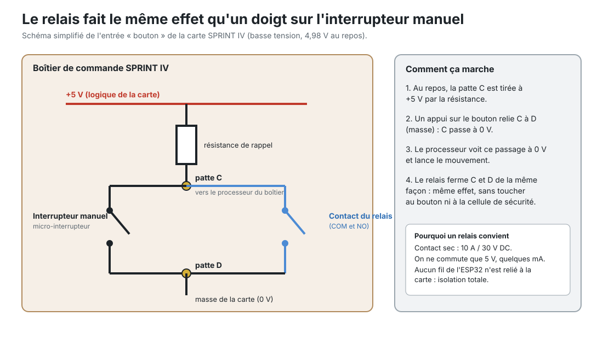
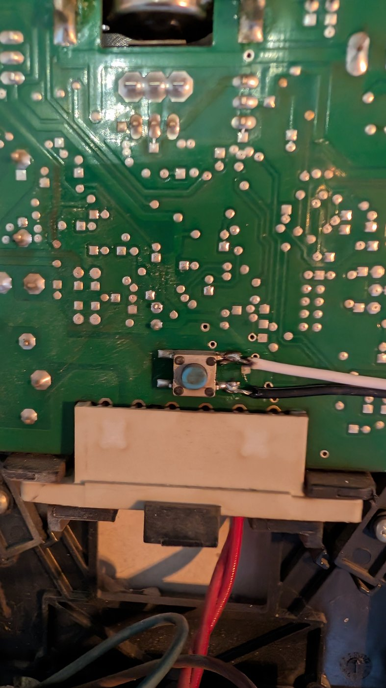
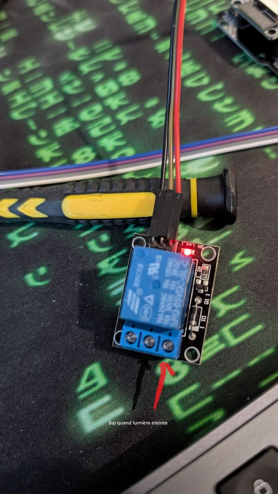
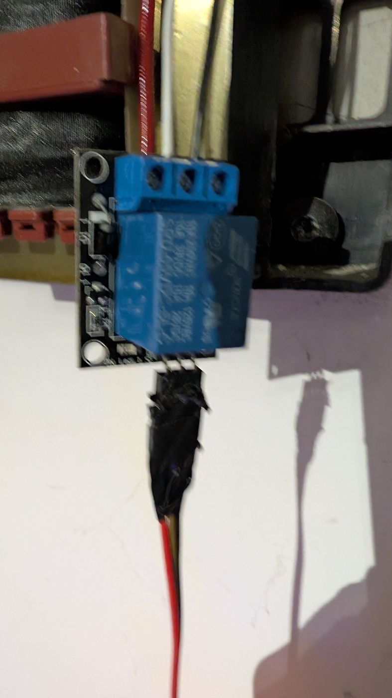

# 5. Souder le relais sur le bouton

[English version](en/05-soldering-the-relay.md)

> **Courant coupé au disjoncteur** pour toute cette étape. Vérifier avec le multimètre ou une lampe que la motorisation n'est plus alimentée avant de toucher la carte.

## Principe

On relie les deux contacts du relais (**COM** et **NO**) aux deux pattes **C** et **D** du micro-interrupteur (guide 3). Le sens ne compte pas : COM peut aller sur C ou sur D.

Résultat sur la carte du boîtier de commande : fil **blanc** sur la patte supérieure droite, fil **noir** sur la patte inférieure droite du micro-interrupteur (les deux pattes de gauche, A et B, ne sont pas touchées).

## Matériel

- 2 fils fins isolés (environ 0,5 mm²), longs d'environ 30 cm.
- Fer à souder fin, étain, une pince.
- Chatterton ou gaine pour isoler.

## Étapes

1. **Dénuder** 3 mm au bout de chaque fil et **étamer** légèrement.
2. **Souder** un fil sur la patte **C** et l'autre sur la patte **D** du micro-interrupteur, **côté soudures** de la carte. Opérer rapidement (2 à 3 secondes par patte) et éviter de toucher les pistes voisines.
3. Faire un **point de colle ou un tour de chatterton** sur chaque fil près de la soudure : tirer sur le fil ne doit pas arracher la patte.
4. **Dénuder** l'autre bout de chaque fil (5 mm) et le passer sous une **vis du bornier du relais** :
   - un fil sous **COM** (vis du milieu),
   - l'autre sous **NO** (vis de gauche sur la photo du guide 2).
   Ne **pas** utiliser NC.
5. **Serrer** les vis et tirer doucement sur chaque fil pour vérifier la tenue.

Il est déconseillé de pincer une broche Dupont dans le bornier à vis : le contact est incertain et peut se desserrer avec les vibrations de la porte. Utiliser un fil dénudé.

## Contrôle au multimètre (courant toujours coupé)

1. Multimètre en **continuité**.
2. Poser les deux pointes sur les **deux vis COM et NO** du bornier du relais.
3. **Appuyer sur l'interrupteur manuel** du boîtier de commande : le multimètre doit **biper** pendant l'appui et se taire au relâchement.

Ce test prouve que les fils soudés sur C et D arrivent bien aux vis du relais.

## Premier essai avec la motorisation

1. Mettre l'ESP32 sous tension, **mode simulation désactivé**.
2. Remettre le courant de la motorisation.
3. Dégager la zone de la porte (personne, voiture, objet) : **la porte va bouger**.
4. Appuyer sur **Ouvrir** dans l'appli : le relais clique et la porte démarre.
5. Vérifier que le **interrupteur manuel d'origine** fonctionne toujours, et que la **télécommande d'origine** aussi.
6. Vérifier que la porte **s'arrête sur un obstacle** (cellule de sécurité), comme avant.

La suite : [détecteur de mouvement manuel](09-detecteur-mouvement-manuel.md) et [installation dans le boîtier](10-installation-dans-le-boitier.md).
