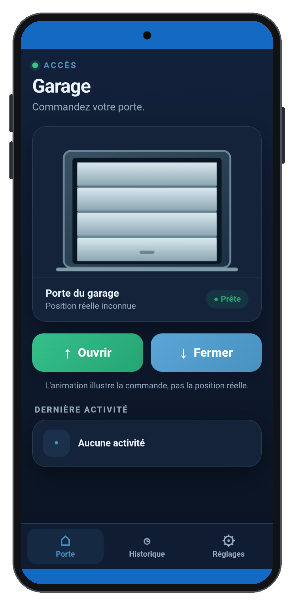
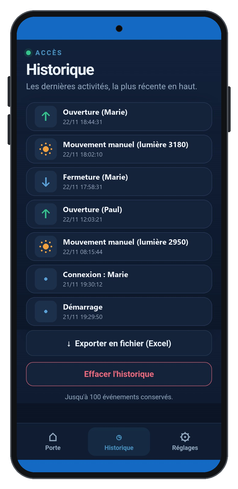
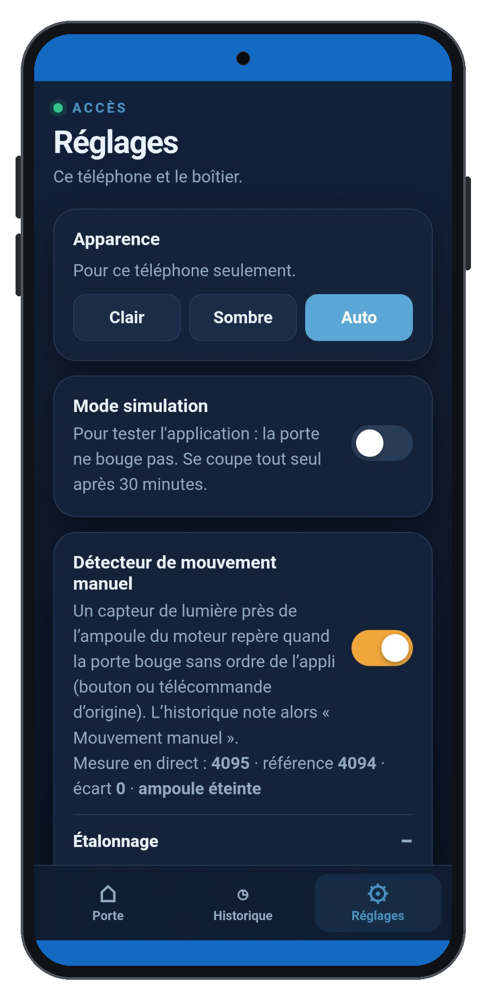
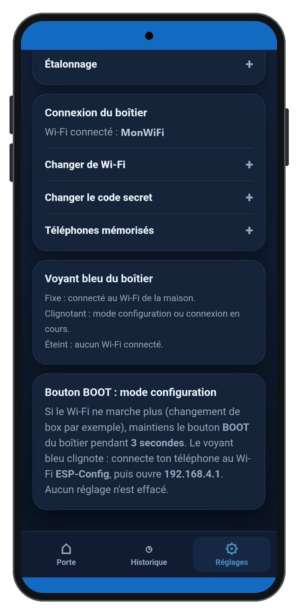

# 7. Premier démarrage et utilisation

[English version](en/07-first-start-and-use.md)

## Premier démarrage : le Wi-Fi de réglage

Un ESP32 neuf (ou après un appui long sur BOOT) ouvre son propre Wi-Fi ouvert, nommé **`ESP-Config`** :

1. Sur le téléphone, se connecter à **`ESP-Config`**.
2. Ouvrir **`http://192.168.4.1`**. Le système du téléphone tente d'ouvrir seul la page de configuration (portail captif) en interrogeant une adresse de test : `generate_204` sur Android, `hotspot-detect.html` sur iOS, `connecttest.txt` sur Windows. Le boîtier répond à ces trois requêtes. Si la fenêtre ne s'ouvre pas (DNS privé actif, données mobiles prioritaires, ou version du système qui ne l'affiche pas), saisir l'adresse à la main dans le navigateur.
3. Renseigner :
   - le **nom du Wi-Fi de la maison** : à saisir, ou à choisir dans la recherche des réseaux. Un réseau **caché** se saisit à la main ;
   - son **mot de passe** ;
   - un **code secret** de **6 caractères au minimum**. Si un code existe déjà, il faut le retaper pour confirmer.
4. Enregistrer : l'ESP32 redémarre et se connecte au Wi-Fi de la maison.

Les noms visibles du réseau sont **volontairement neutres** (`ESP-Config`, `esp-acces`) : ils ne disent ni « porte » ni « garage ».

## Le voyant (LED bleue de la carte)

| LED | Signification |
|---|---|
| **Fixe** | Connecté au Wi-Fi de la maison |
| **Clignotante** | Mode configuration, ou connexion en cours |
| **Éteinte** | Aucun Wi-Fi connecté |

## Bouton BOOT : revenir au mode configuration

Si le Wi-Fi ne marche plus (changement de box, par exemple), **maintenir le bouton BOOT 3 secondes**. La LED clignote : se connecter au Wi-Fi `ESP-Config` et ouvrir `192.168.4.1`. **Aucun réglage n'est effacé.**

## Trouver l'ESP32 sur le réseau

- Nom : **`http://esp-acces.local`** (selon le système du téléphone).
- Ou son **adresse IP**. Recommandé : créer dans la box une **réservation DHCP** pour que l'adresse ne change plus.

## Se connecter depuis un téléphone

1. Ouvrir l'adresse dans le navigateur du téléphone.
2. Saisir le **code secret** et le **prénom**. Le prénom apparaîtra dans l'historique.
3. Le téléphone est **mémorisé** par un cookie sécurisé valable un an. **8 téléphones** au maximum.

Un cookie est propre à chaque adresse : en cas d'utilisation de `http://esp-acces.local` **et** l'adresse HTTPS du guide 8, le téléphone doit se connecter une fois sur chacune.

## Les écrans

- **Porte** : dessin animé de la porte, boutons **Ouvrir** (vert) et **Fermer** (bleu), dernière activité. L'état affiché est **déduit de la dernière demande** (il n'y a pas de capteur de position). Les deux boutons envoient la **même impulsion** ; la motorisation décide du sens. En cas de répétition de la même commande, l'appli prévient et propose **Forcer**.
- **Historique** : 100 évènements défilants (qui, quoi, quand), **export en fichier CSV**, bouton **Effacer l'historique** avec confirmation.
- **Réglages** : thème clair, sombre ou automatique ; **mode simulation** ; détecteur de mouvement manuel ; Wi-Fi ; changement de code secret ; téléphones mémorisés ; légende de la LED ; explication du bouton BOOT.

### Écran Porte

L'animation illustre la commande envoyée, pas la position réelle. La pastille « Prête » indique que le boîtier accepte un ordre.

### Écran Historique

Chaque ligne indique l'évènement, la personne concernée et l'horodatage. Types d'évènements : **Ouverture** et **Fermeture** (ordre donné depuis l'appli, avec le prénom, suffixe « simulation » en mode simulation), **Mouvement manuel (lumière N)** (interrupteur manuel ou télécommande d'origine, détecté par le capteur de lumière ; N est l'écart mesuré, sur 4095, entre la lumière de référence et la lumière relevée à la détection), **Connexion** (nouveau téléphone), **Mot de passe faux n/5**, **Démarrage** et **Historique effacé**. Les prénoms et dates de la capture sont des exemples.

### Écran Réglages

## Le mode simulation

Dans **Réglages**, l'interrupteur « Mode simulation » fait que **les ordres sont notés mais le relais ne clique pas**. Un bandeau orange s'affiche sur toutes les pages. Il est gardé en mémoire vive seulement : il **s'éteint tout seul après 30 minutes** et à chaque redémarrage. À utiliser pour tester l'appli sans bouger la porte.

## Installer l'appli sur l'écran d'accueil

- **Android (Chrome)** : l'installation demande une adresse **HTTPS** : voir le [guide 8](08-https-reseau-maison.md). Sans HTTPS, seul l'ajout d'un raccourci est possible.
- **iPhone (Safari)** : ouvrir l'adresse, toucher **Partager**, **Sur l'écran d'accueil**, **Ajouter**, puis ouvrir l'appli depuis l'icône.

## Limites de l'appli

- L'état « ouverte / fermée » est une **supposition** (dernière demande), pas la réalité.
- Le HTTP n'est **pas chiffré** sur le réseau de la maison. Voir [Sécurité et limites](11-securite-et-limites.md).
