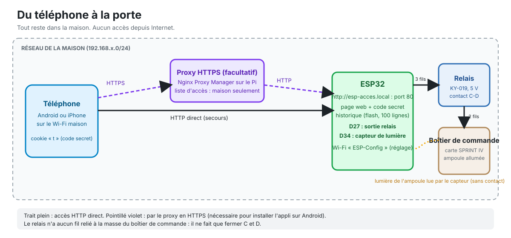

# 8. Adresse HTTPS, réservée au réseau de la maison

L'ESP32 parle en HTTP simple. Pour **installer l'appli comme une vraie application** sur Android (et avoir le cadenas), il faut une adresse **HTTPS**. On ajoute donc un « proxy inverse » sur un petit serveur de la maison (ici un Raspberry Pi avec Docker). **Ce guide est facultatif.**

## Principe

- Un nom gratuit chez **DuckDNS** (par exemple `acces.exemple.duckdns.org`) pointe vers l'adresse publique de la box.
- La box redirige le port **443** vers le Raspberry Pi.
- **Nginx Proxy Manager** (NPM) sur le Pi reçoit la demande, présente un certificat **Let's Encrypt** valide, puis la transmet à l'ESP32 en `http://<ip-de-l-esp32>:80`.
- Une **liste d'accès** dans NPM n'autorise que le réseau de la maison (`192.168.x.0/24`) et refuse tout le reste.

## Étapes

1. **DuckDNS** : créer un sous-domaine et tenir à jour l'IP publique (script ou tâche planifiée).
2. **NPM** : l'installer avec Docker. Si les ports 80 et 443 du Pi sont déjà pris, utiliser par exemple 18080 (HTTP), 18081 (administration) et 18443 (HTTPS), puis rediriger le **443 de la box** vers **18443** du Pi.
3. **Liste d'accès** : créer une liste « porte_garage » : *Allow* `192.168.1.0/24` (à adapter au réseau local), puis *Deny all*.
4. **Hôte proxy** : domaine `acces.exemple.duckdns.org` → `http://<ip-esp32>:80`. Onglet SSL : demander un certificat Let's Encrypt, activer « Force SSL ». Onglet principal : choisir la liste d'accès.
5. **Résolution locale** : à la maison, le téléphone doit joindre le Pi quand il demande ce nom. Beaucoup de box gèrent mal le retour (« hairpin NAT ») : le plus simple est de déclarer ce nom dans le DNS local (Pi-hole, AdGuard, ou la box si elle le permet) vers l'IP du Pi.

## À ne jamais retirer

La **liste d'accès** : l'objectif est que l'appli ne soit **pas joignable depuis Internet**. Le certificat Let's Encrypt est valide, mais seul le réseau de la maison peut utiliser la porte.

## Vérifier

- **Dans la maison** (Wi-Fi) : `https://acces.exemple.duckdns.org` doit afficher la page avec un cadenas.
- **Hors de la maison** (4G, Wi-Fi coupé) : l'adresse doit répondre **403 Forbidden**. Si la page de connexion apparaît, la liste d'accès est mal réglée : à corriger immédiatement.

## Installer l'appli sur Android

Ouvrir l'adresse HTTPS dans Chrome, menu ⋮, **Installer l'application**. L'icône apparaît avec le nom « Accès ». Le fichier `manifest.json` et les icônes 192/512 sont servis par l'ESP32.

## Limite

Le trafic entre le Pi et l'ESP32 reste en HTTP sur le réseau local. Voir [sécurité](11-securite-et-limites.md).
