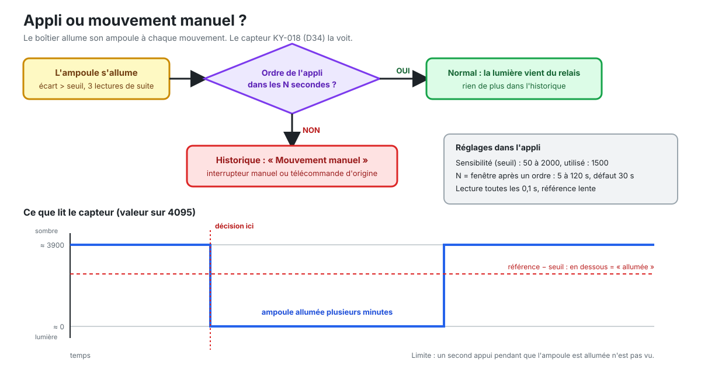
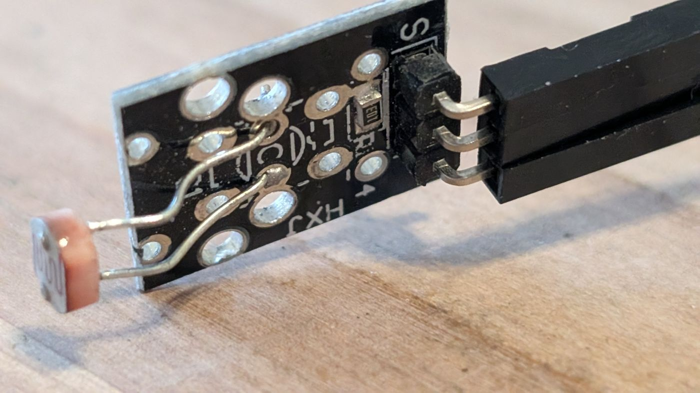
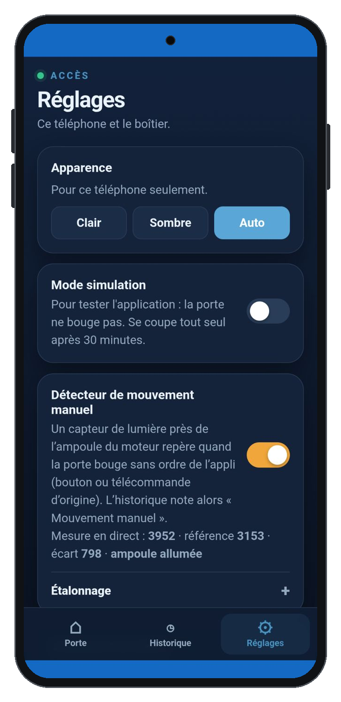
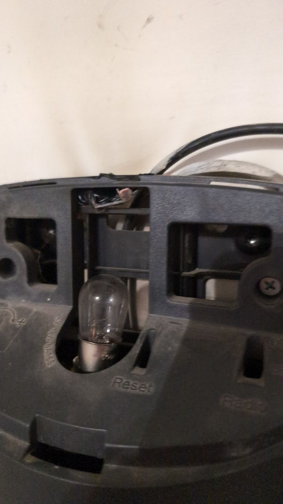

# 9. Détecteur de mouvement manuel (lumière)

## Le problème

Quand quelqu'un appuie sur le **vrai interrupteur manuel** ou la **télécommande d'origine**, l'ESP32 n'en sait rien : le relais n'est pas touché. L'historique de l'appli manquerait donc des mouvements de porte.

Aucun fil n'est posé sur la carte du boîtier de commande (isolation du secteur non vérifiée). Solution sans contact : le boîtier **allume son ampoule** à chaque mouvement (pendant plusieurs minutes). Un capteur de lumière posé contre l'ampoule voit l'allumage.

## Le capteur

Module **KY-018** (photorésistance) : 3 broches S, +, −. Plus il y a de lumière, plus la valeur lue **baisse** (ampoule contre le capteur : proche de 0 ; obscurité : 3150 à 3950 sur 4095).

Branchement : voir le [guide 4](04-branchements-esp32.md) (D34 : S, V, G). **D34** est une entrée de l'ADC1, utilisable avec le Wi-Fi allumé.

## Principe du programme

1. Lecture **toutes les 0,1 s**.
2. Une **valeur de référence lente** (moyenne glissante) suit la lumière ambiante : jour, nuit, nuages.
3. La lumière est « allumée » si l'écart avec la référence dépasse le **seuil** **3 fois de suite** (filtre contre les parasites).
4. À l'allumage, le programme vérifie si un **ordre de l'appli** a été donné dans les **N secondes précédentes** (fenêtre, 30 s par défaut). Si oui : c'est le relais, rien à noter. Sinon : ligne **« Mouvement manuel (lumière N) »** dans l'historique, où **N est l'écart mesuré** (référence moins valeur lue, sur 4095) : une valeur proche du seuil indique une détection limite, une valeur très supérieure une détection franche.
5. Si la lumière reste fausse pendant 10 minutes (changement lent, ombre), la référence est reprise.

L'état de l'appli est aussi mis à jour : si la porte bouge sans demande, l'appli n'affiche plus un état périmé.

## Réglages dans l'appli

Page **Réglages**, bloc « Détecteur de mouvement manuel » :

| Réglage | Rôle | Valeur testée |
|---|---|---|
| Activé | Marche / arrêt du détecteur | oui |
| **Sensibilité (seuil)** | Écart à dépasser, de 50 à 2000. Plus petit = plus sensible. | 1500 (défaut 400) |
| **Fenêtre après un ordre** | Secondes pendant lesquelles un allumage est attribué à l'appli, de 5 à 120. | 30 s |

La **mesure en direct** (valeur, référence, écart) permet d'étalonner le détecteur : le tableau suivant aide.

| Observation | Action |
|---|---|
| L'écart n'atteint jamais le seuil quand l'ampoule s'allume | Baisser le seuil |
| Des « mouvements » apparaissent sans raison | Augmenter le seuil |
| Un ordre de l'appli est noté comme manuel | Augmenter la fenêtre |
| Le mouvement manuel suit un ordre mais est attribué à l'appli | Réduire la fenêtre |

## Pose

- Placer le capteur **contre l'ampoule** (la fente du capot) pour que la lumière du garage ne perturbe pas.
- **L'ampoule chauffe** (ampoule à incandescence de 18 W, culot BA15S) : ne pas toucher le verre avec le capteur ni les fils. Le ruban adhésif ordinaire n'est pas prévu pour la chaleur : prévoir une cale ou du ruban résistant.
- L'étalonnage doit se faire **une fois installé** : sur le bureau, les valeurs ne sont pas représentatives.

## Limites

- Un **second appui** pendant que l'ampoule est **déjà allumée** n'est **pas visible**.
- La lumière du jour qui entre dans le boîtier peut baisser le contraste : régler le seuil en conséquence.
- La détection n'indique **pas le sens** du mouvement (ouverture ou fermeture).
