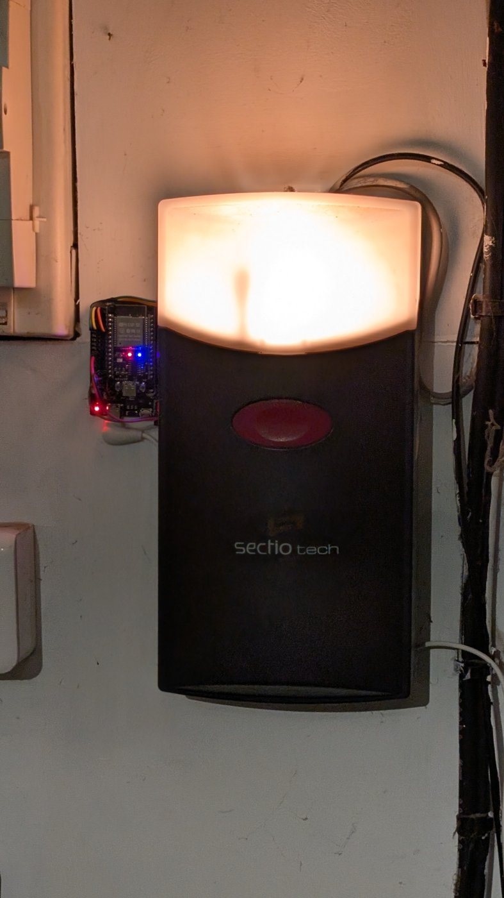
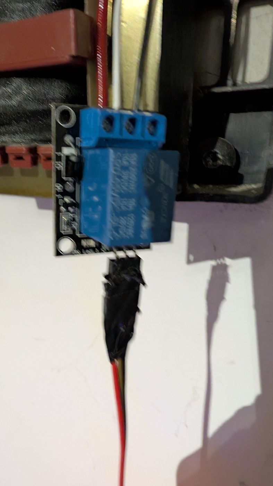

# 10. Installation dans le boîtier de commande

[English version](en/10-installation.md)

## Idée

Le relais et le capteur sont dans le boîtier de commande ; l'ESP32 et sa plaque sont fixés **au mur, à côté du boîtier** (photo ci-dessous, de nuit : l'ampoule du boîtier de commande est allumée). Les fils entrent dans le boîtier par le haut.

## Alimentation

Une alimentation **prélevée sur la carte du boîtier de commande** (sortie basse tension) a été envisagée, puis écartée.

- La carte n'a pas de notice : la tension réelle et l'isolation ne sont pas connues par rapport au secteur.
- Un ESP32 plus un relais tirent 100 à 250 mA : cela pourrait gêner la motorisation.
- **Solution retenue** : un chargeur USB classique (5 V, 1 A ou plus) sur une prise 230 V, avec un câble passé par le capot, **hors de la zone 230 V** du boîtier de commande.

Ne **jamais** relier la masse de l'ESP32 à celle de la carte du boîtier de commande.

## Où mettre quoi

- **Relais** : fixé dans le boîtier, les deux fils vers C et D courts.
- **ESP32 + plaque** : fixés au mur contre le boîtier, **hors de la zone du transformateur**, avec les fils aussi courts que possible ; alimentation par un câble USB blanc vers un chargeur.
- **Capteur** : contre l'ampoule (guide 9).

Le double-face utilisé n'est **pas conducteur**, ce qui évite un court-circuit entre les broches ; une vérification au multimètre reste recommandée.

## Sécuriser les fils Dupont

Les broches Dupont se desserrent avec les vibrations de la porte.

1. Brancher tous les fils.
2. Ajouter des tours de **chatterton** autour de chaque connecteur et de la plaque (de la gaine thermorétractable n'aide pas sur des broches femelles).
3. Faire un **test de traction léger** sur chaque fil.
4. Pour un montage définitif : souder les fils sur une plaque à trous ou utiliser des bornes à vis.

Après tout déplacement de fils, refaire le test du relais (clic) et contrôler la mesure du capteur.

## Contrôle final

1. L'appli ouvre et ferme la porte.
2. L'interrupteur manuel et la télécommande d'origine marchent.
3. La cellule de sécurité arrête toujours la porte.
4. Le détecteur de lumière note un appui sur l'interrupteur manuel.
5. Après une coupure de courant, l'ESP32 redémarre seul, **relais au repos**.
6. Rien n'est brûlant ni mal fixé ; les fils ne touchent ni l'ampoule ni le transformateur.
