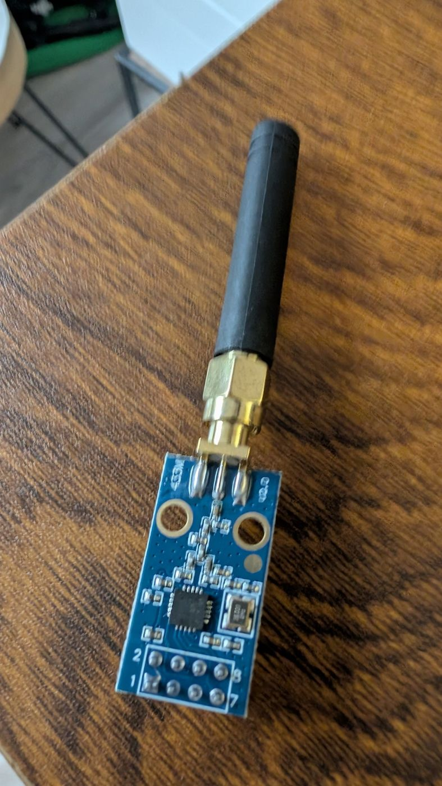
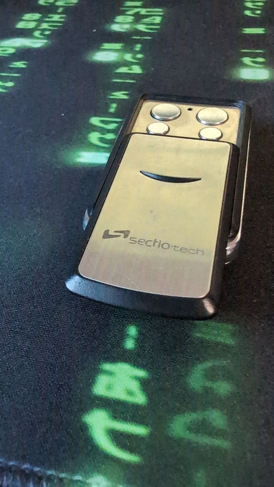
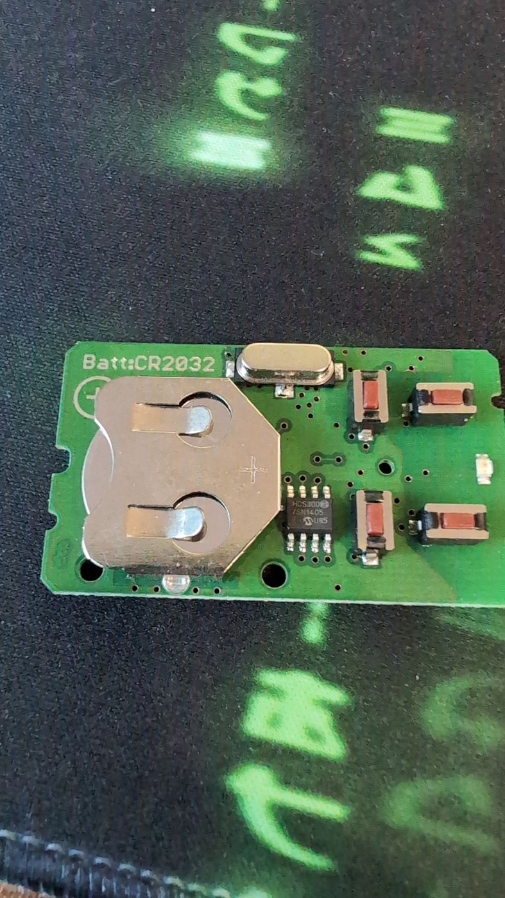

# 13. L'histoire du projet

[English version](en/13-project-history.md)

Pourquoi ce montage est ainsi, et ce qui a été essayé avant.

## 1. L'idée

Ouvrir et fermer une porte de garage depuis le smartphone **en arrivant en voiture**, sur le Wi-Fi de la maison. Pas de Bluetooth. Pas d'accès direct depuis Internet. Une personne a un Android, l'autre un iPhone avec CarPlay filaire.

## 2. Première piste : copier la télécommande radio

Première approche : **copier la télécommande d'origine** avec un module radio. Cette approche a été testée puis écartée : la télécommande (Sectio-Tech) contient une puce **HCS300**, à **code tournant (« rolling code », KeeLoq)**. Chaque appui envoie un code différent, impossible à rejouer sans la clé du fabricant. Un module radio **CC1101** a été câblé et validé (version 0x14), mais la copie n'est **pas possible**. L'idée est abandonnée, et c'est ce qui a mené au relais.

**Point de contrôle** : avant d'acheter un module radio, relever la référence de la puce de la télécommande. Un HCS200, HCS300, HCS301 ou toute puce KeeLoq indique un code tournant : la copie radio est exclue.

Point de vigilance : **ne jamais inverser VCC et GND d'un CC1101** (surchauffe), et repérer les fils par **numéro de broche**, pas par couleur.

## 3. La solution : un relais en parallèle de l'interrupteur manuel

Le boîtier de commande a un **gros interrupteur manuel** rouge qui appuie sur un micro-interrupteur. Un relais dont les contacts sont montés **en parallèle** de ce micro-interrupteur fait la même chose qu'un doigt, sans toucher aux circuits de sécurité. Les pattes C et D ont été repérées au multimètre (4,98 V continu au repos : entrée basse tension).

## 4. L'application dans l'ESP32

Les premières versions utilisaient le serveur web `WebServer`, avec un **retard parfois très long** du relais. Migration vers **`esp_http_server`** : retard disparu. L'interface est d'abord dessinée dans une **page de démonstration** (`docs/demo/demo.html`, données d'exemple) avant d'être portée dans le programme. La page est compressée en gzip et occupe environ 10 Ko.

- Connexion par code secret + prénom, cookie sécurisé.
- Historique de 100 évènements en flash.
- Mode simulation.
- Configuration Wi-Fi par portail captif `ESP-Config`.
- Mise à jour OTA.

## 5. HTTPS réservé au réseau de la maison

Pour installer l'appli sur Android, il faut du HTTPS : un proxy Nginx Proxy Manager sur un Raspberry Pi, certificat Let's Encrypt, **liste d'accès** limitée au réseau de la maison.

## 6. Détecter les mouvements manuels

Faute de pouvoir « écouter » l'interrupteur manuel sans risque d'isolation, le choix a été : **photorésistance contre l'ampoule du boîtier de commande**. Plusieurs problèmes rencontrés :

- Référence qui restait bloquée après un échelon de lumière : ajout d'une **reprise de référence après 10 minutes**.
- Seuil par défaut trop sensible en situation réelle : réglages dans l'appli (sensibilité 1500).
- Limite : second appui pendant que l'ampoule est allumée.

## 7. Pannes et leçons

- Limite de **20 routes** HTTP : la 21e était ignorée sans erreur. Portée à 32.
- Un **fil de signal du relais sur la mauvaise rangée** : plus de clic. Toujours repérer D27 par son nom imprimé.
- Un relais alimenté en **3,3 V** ne colle pas : il faut **5 V**.
- **Alimentation depuis la carte du boîtier de commande** : refusée (pas de notice, isolation inconnue).

## 8. Idées pour la suite

- **Notifications** sur téléphone (Webpush).
- **Capteur de position** infrarouge pour connaître le vrai état de la porte.
- Détecter le **vrai interrupteur manuel** avec un montage isolé (optocoupleur PC817 + MOSFET 2N7000 sur C et D, sans jamais relier les masses).
- Heure sur la ligne « Démarrage ».
- Tableau de bord commun (Home Assistant).
