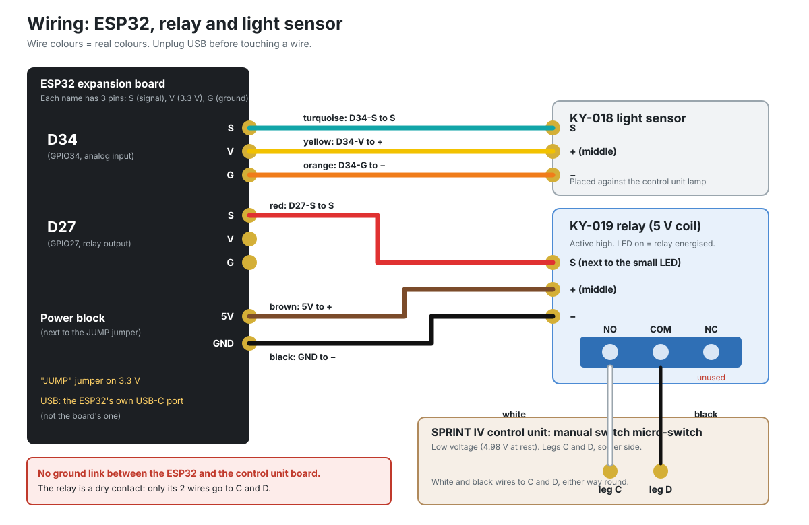
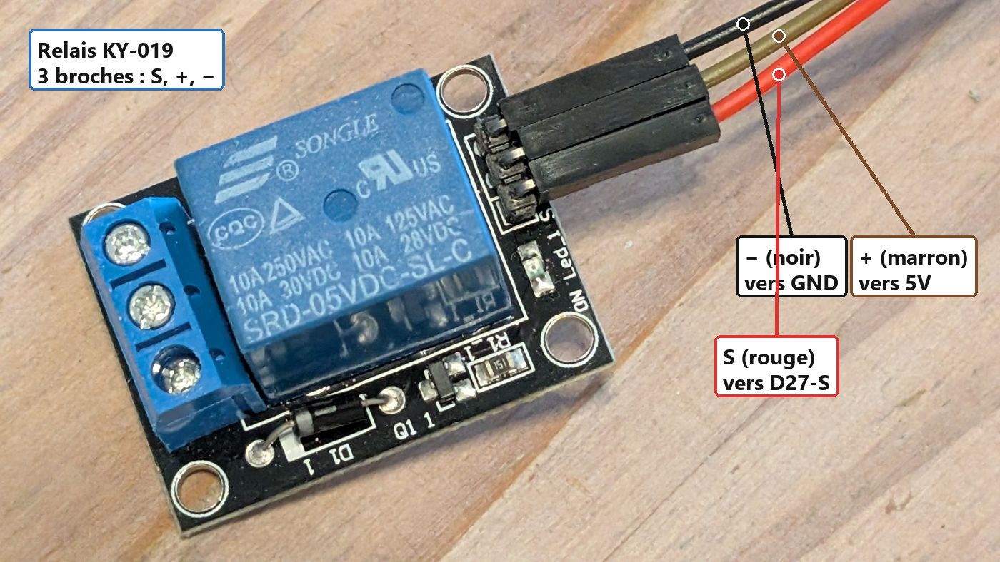
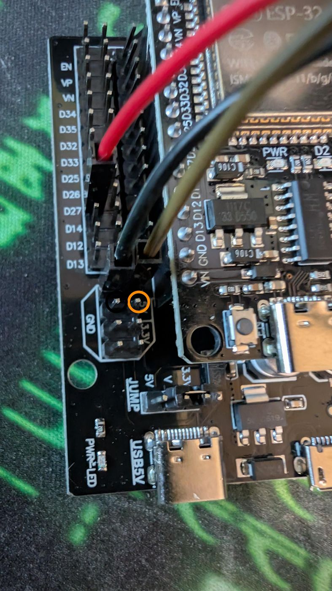
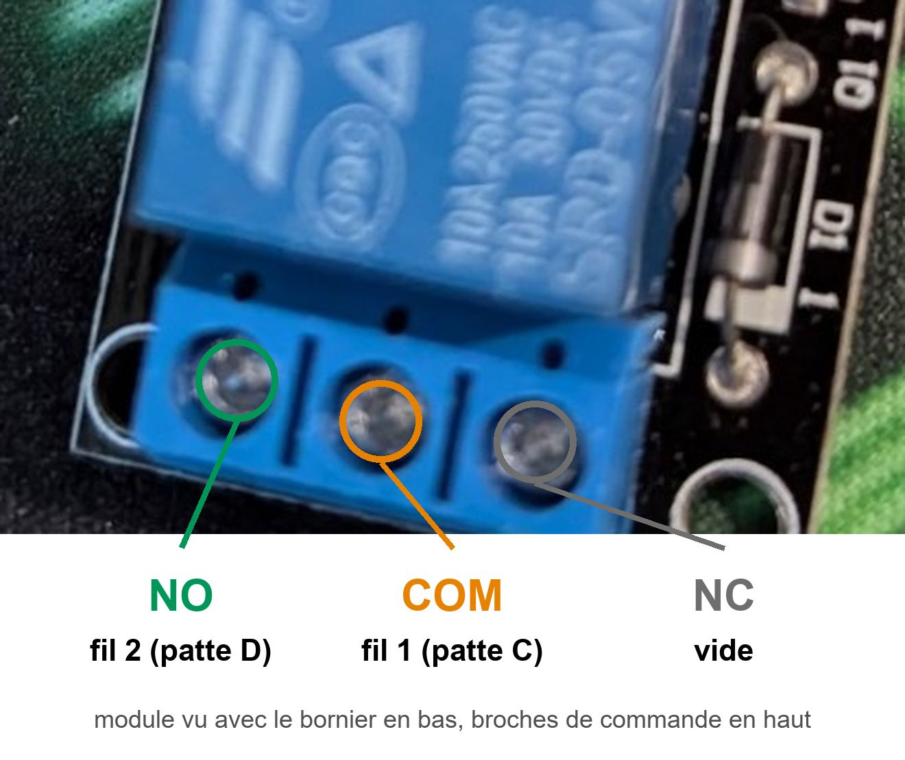
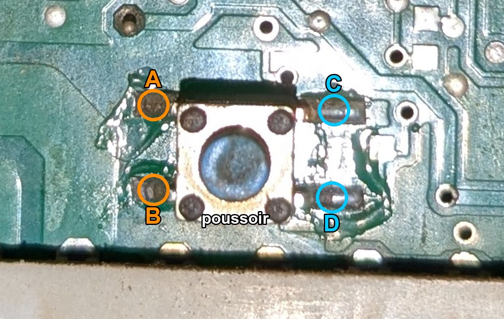
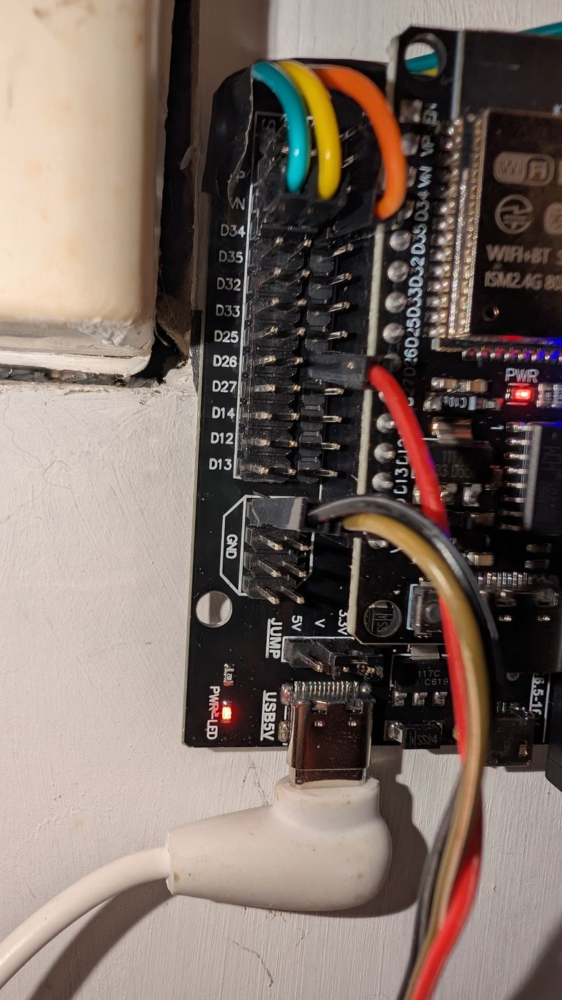

# Wiring reference

[Version française](../00-fiche-de-cablage.md)

Wiring reference for the whole assembly: wire colours, module pins, expansion board pins. **Unplug the ESP32 from USB before working on any wire.**

Expansion board convention: each printed name (D27, D34...) corresponds to **3 pins** in a line: **S** (signal, on the name side), **V** (middle, 3.3 V with the jumper), **G** (ground).

## 1. KY-019 relay (door command)

3-wire Dupont connector on the relay. On the relay board the pins are marked **S**, **+**, **−** (**S** is the closest to the small `Led_1` LED).

| Wire | Relay pin | Goes to the ESP32 board | Why |
|---|---|---|---|
| **Red** | **S** (signal) | column **D27**, row **S** | D27 is the output driving the relay (high = relay energised) |
| **Brown** | **+** (middle) | 5V / GND block (next to the JUMP jumper), **5V** pin | the relay coil needs 5 V; the V row only supplies 3.3 V |
| **Black** | **−** | 5V / GND block (next to the JUMP jumper), **GND** pin | common ground with the ESP32 |

Relay contacts (blue screw terminal): **COM** (middle screw) and **NO** (left screw). **NC (right): unused.**

These two screws are connected by 2 wires to legs **C** and **D** of the manual switch micro-switch, on the control unit board (either way round):

| Wire | Relay screw | Control unit board leg |
|---|---|---|
| **White** | NO or COM | C or D |
| **Black** | the other screw | the other leg |

Why NO and COM: the contact is **open at rest** and only closes when the relay energises, like the manual switch. With NC, the door would be commanded permanently, except during the pulse. Legs C and D are the ones that close when the button is pressed (guide 3).

## 2. KY-018 light sensor

3-wire Dupont connector on the sensor. On the sensor board the pins are, from left to right (solder side, "S" text at the top left): **S**, **middle (+)**, **−**.

| Wire | Sensor pin | Goes to the ESP32 board | Why |
|---|---|---|---|
| **Turquoise** | **S** (signal) | column **D34**, row **S** | D34 is an analog input (ADC1), usable with Wi-Fi active |
| **Yellow** | **+** (middle) | column **D34**, row **V** (3.3 V) | the sensor is powered at 3.3 V to stay within the ESP32 reading range |
| **Orange** | **−** | column **D34**, row **G** | sensor ground |

The sensor is on **D34** (GPIO34, analog input). The row just above is called **VN**: **it is not the right one**, the program does not read VN.

## 3. Power supply

White USB cable (5 V charger) into the **ESP32's USB-C port** (not the board's). Board jumper on **3.3 V**.

## 4. Checks after any wiring change

1. The red **PWR** LED of the board is on.
2. In the app, Settings: the sensor reading changes with the lighting.
3. **Open** button with **simulation mode off**: the relay clicks and its LED lights for 1 second.
4. No click or LED: measure 5 V between the brown and black relay wires (4.6 to 5 V expected).

## 5. Never do

- **Never** connect the ESP32 ground to the control unit board ground.
- Do not put the relay **brown** wire on V (3.3 V): the relay will not energise.
- Do not solder anything on legs **A** and **B** of the micro-switch.
- Do not touch anything on the 230 V side (transformer lugs) without switching off the circuit breaker.
