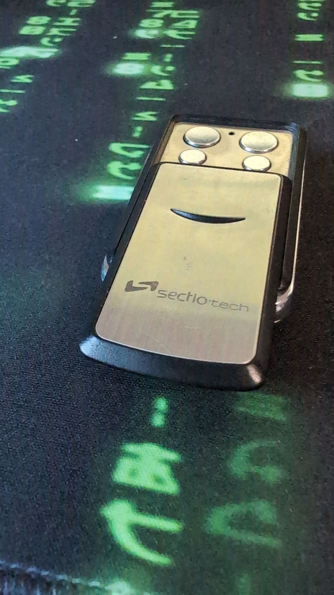
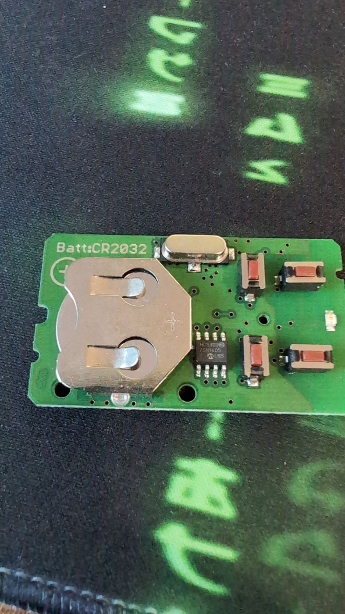
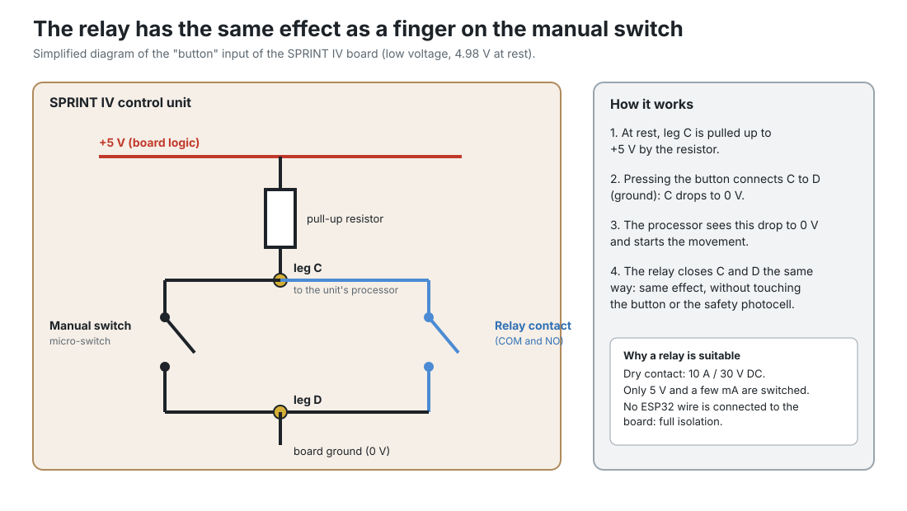
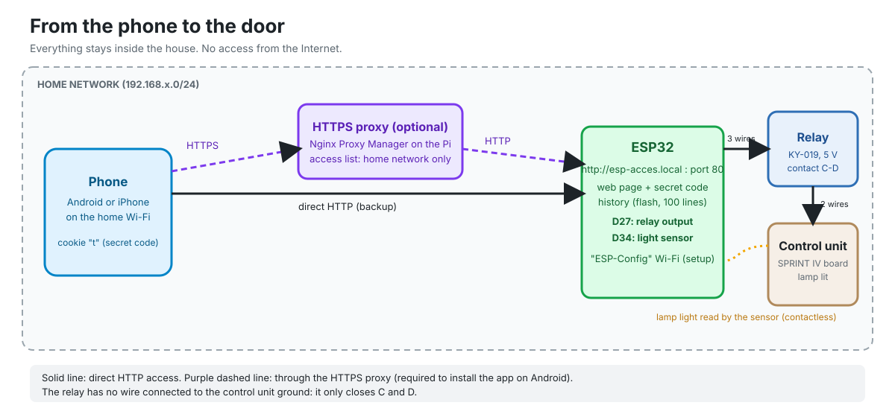

# 1. Principle and choices

[Version française](../01-principe-et-choix.md)

## The goal

Open and close the garage door **from a smartphone when arriving by car**, over the home Wi-Fi. An Android phone and an iPhone (with wired CarPlay) must both be able to do it.

Constraints set from the start:

- **No Bluetooth.** Safari on iPhone does not support Web Bluetooth: a web page is the only solution that works on both systems without installing an app from a store.
- **No direct access from the Internet.** A garage door must not be reachable from outside. If remote opening becomes necessary, use a VPN.
- **The phone's Wi-Fi must connect within a few seconds** when the car arrives in the driveway.

## First idea: copy the radio remote (abandoned)

The original remote (4 buttons, CR2032 battery) transmits on 433.92 MHz. The idea: copy it with a **CC1101** radio module connected to the ESP32.

When opened, the remote board carries an **HCS300** chip (Microchip), a **KeeLoq rolling-code** encoder: the code changes at every press. Copying one press is then useless, as the motorisation would reject the replayed code.

To check: press the same button three times and compare the three transmissions. Identical = fixed code (replay works). Different = rolling code (replay fails). Here: rolling code, so **radio copy is impossible**.

The CC1101 module was still used for tests (see [Project history](13-project-history.md)) but it is **no longer used**.

## Second idea: a relay on the control unit button (chosen)

The control unit has a red **manual switch** on its cover. It presses a micro-switch on the electronic board. A **relay in parallel** with this micro-switch lets the ESP32 "press" in place of a person.

Advantages:

- No modification of the motorisation, just two wires soldered on the micro-switch legs.
- The **original manual switch and the original remote keep working**.
- The motorisation's **safety photocell** stays active: the relay only duplicates a press.

## What the relay does not tell

The motorisation returns no information about the door position. The relay sends the **same pulse** to open and to close: the motorisation decides the direction (open if the door is closed, and vice versa). The app therefore records the last request but **does not know the real position**.

To know whether the door moved without going through the app, a **light sensor** is added next to the control unit lamp (guide 9). A position sensor (infrared, magnet) remains a possible improvement.

## Architecture

The ESP32 hosts a lightweight web page. The phone connects to it over the home Wi-Fi. Optionally, an HTTPS proxy (guide 8) in front of the ESP32, restricted to the home network, allows installing the app on Android.
