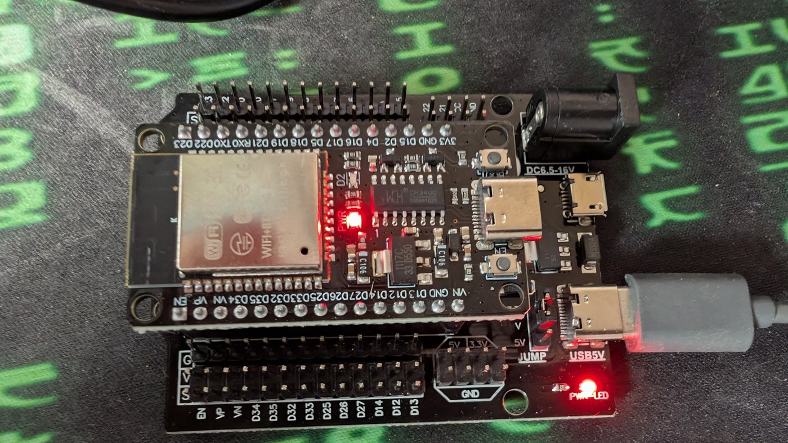
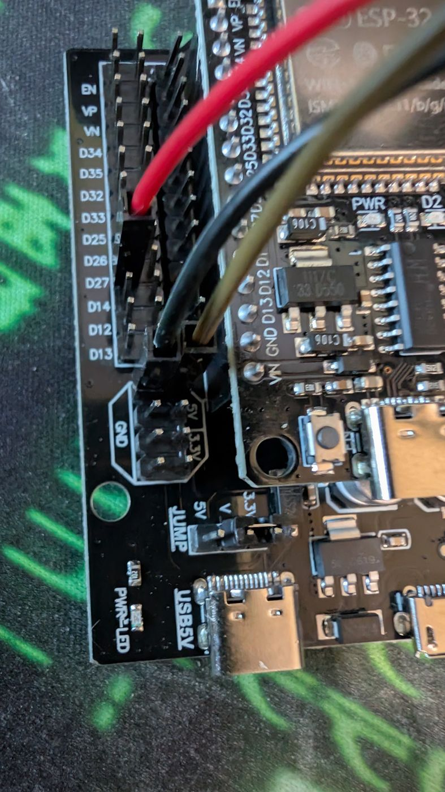
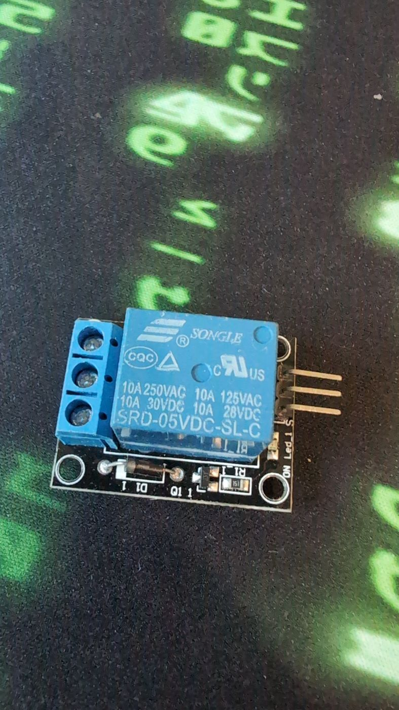
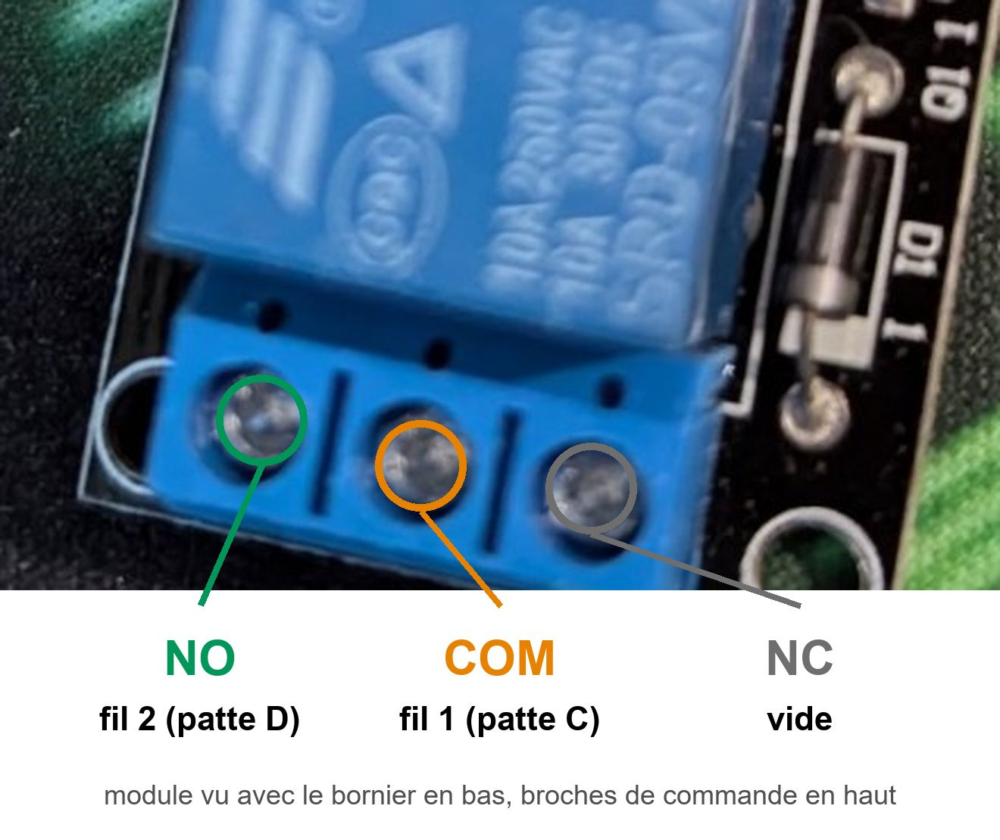
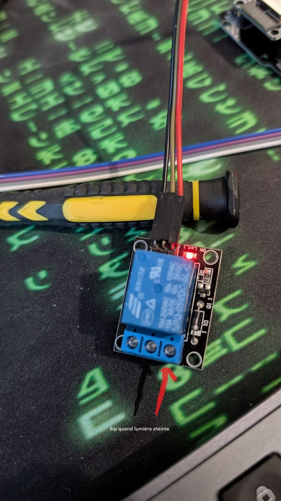

# 2. Parts

[Version française](../02-materiel.md)

## Parts list

| Part | Role | Note |
|---|---|---|
| **ESP32** (DevKit V1, 30 pins, ESP32-WROOM-32, USB-C, CH340 USB-serial chip) | Brain: Wi-Fi, web page, relay, sensor | USB-C port for programming |
| **Expansion board** with G / V / S rows | Plug modules without soldering | With voltage jumper (3.3 V / 5 V) |
| **KY-019 relay** (SRD-05VDC) | Operates the control unit manual switch | 5 V coil, active high, contacts 10 A / 30 V DC |
| **KY-018 light sensor** | Sees the control unit lamp turn on | Photoresistor on a small 3-pin board |
| Female-female **Dupont** wires | Connect modules to the board | About fifteen |
| Thin wire (about 0.5 mm²) | Relay to the control unit manual switch | 2 wires, 20 to 50 cm |
| 5 V (1 A) **USB charger** and USB-C cable | Power the ESP32 | On a nearby socket |
| **Multimeter** | Checks | DC voltage and continuity |
| Fine soldering iron + solder | Soldering on the board | |
| Electrical tape, double-sided tape, cable ties | Fixing and insulating | Double-sided tape must be insulating |

## Cost of the parts

> **Cost of the assembly per unit** (Amazon.fr prices noted on 22/11/2026, cheapest offer for each part, excluding shipping). The ESP32 + board set is the kit actually bought: **pack of 2 sets at €15.99** (price shown on the listing), i.e. **€8.00 per unit**.

| Part | Chosen offer (Amazon.fr) | Pack price | Cost per unit | Quantity used | Cost in the assembly |
|---|---|---|---|---|---|
| ESP32 DevKit V1 30 pins + G / V / S expansion board | [Binghe, pack of 2 sets (bought)](https://amzn.eu/d/0a67U5Ma) | €15.99 | €8.00 | 1 | **€8.00** |
| KY-019 relay | [Pack of 3 KY-019 modules](https://www.amazon.fr/dp/B0D8Q5NKF9) | €5.88 | €1.96 | 1 | **€1.96** |
| KY-018 light sensor | [Pack of 4 KY-018 modules](https://www.amazon.fr/dp/B0D846R9XM) | €15.59 | €3.90 | 1 | **€3.90** |
| Dupont wires | [Pack of 120 wires, 10 cm](https://www.amazon.fr/dp/B0DQ4W15L9) | €7.99 | €0.07 | 6 | **€0.40** |
| Thin wire, tape, double-sided tape | Salvaged | | | | €0.00 |
| 5 V USB charger and USB-C cable | Salvaged | | | | €0.00 |
| **Total for the assembly** | | | | | **≈ €14.26** |

Minimum purchase if no part is available (one pack of each, ESP32 kit included): 15.99 + 5.88 + 15.59 + 7.99 = €45.45. Amazon prices vary: check the links before buying. "Digital photoresistor" modules (DollaTek, DO/AO output on LM393) are **not** equivalent: the KY-018 has 3 pins (S, +, −) and an analog-only output.

For comparison, a replacement original remote or a commercial Wi-Fi module does not always fit this motorisation.

For the optional setup (HTTPS, guide 8): a small server on the network (here a Raspberry Pi with Nginx Proxy Manager) and a free domain name (DuckDNS).

## Photos of the parts

### ESP32 on its board

The board has **three rows** of pins for each ESP32 terminal: **S** (signal, the row closest to the printed name), **V** (voltage) and **G** (ground). A **jumper** (JUMP) selects the voltage of the V row: 3.3 V or 5 V. It stays on **3.3 V** here.

The small **block of pins marked 5V / 3.3V / GND**, next to the JUMP jumper, provides **5 V** and **GND** (ground): this is where the relay power supply is connected.

### KY-019 relay

- Control side (3 pins): **S** (signal), **+** (middle), **−**.
- Power side (screw terminal): **NO** (normally open), **COM** (common), **NC** (normally closed). **COM** and **NO** are used.

The terminal is identified with a multimeter in continuity mode: COM and NO are only connected when the relay is energised.

### KY-018 light sensor

3 pins: **S** (analog output), **+** (3.3 V supply), **−** (ground). The more light, the **lower** the value read.

## Parts not used

- The **CC1101** radio module: see [Project history](13-project-history.md).
- A position sensor (infrared module, reed switch, ultrasonic): not installed.
