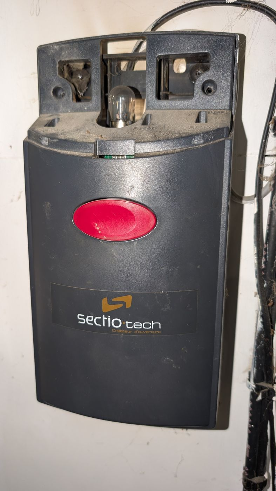
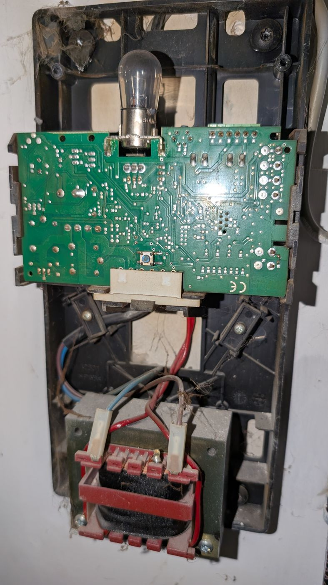
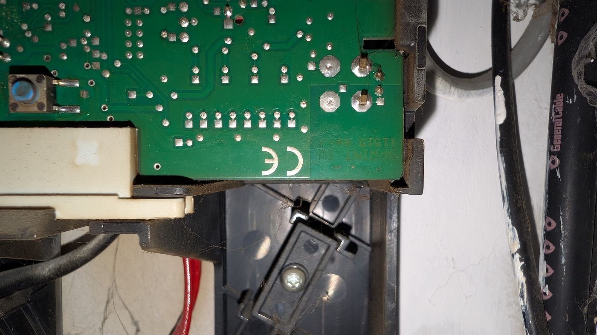
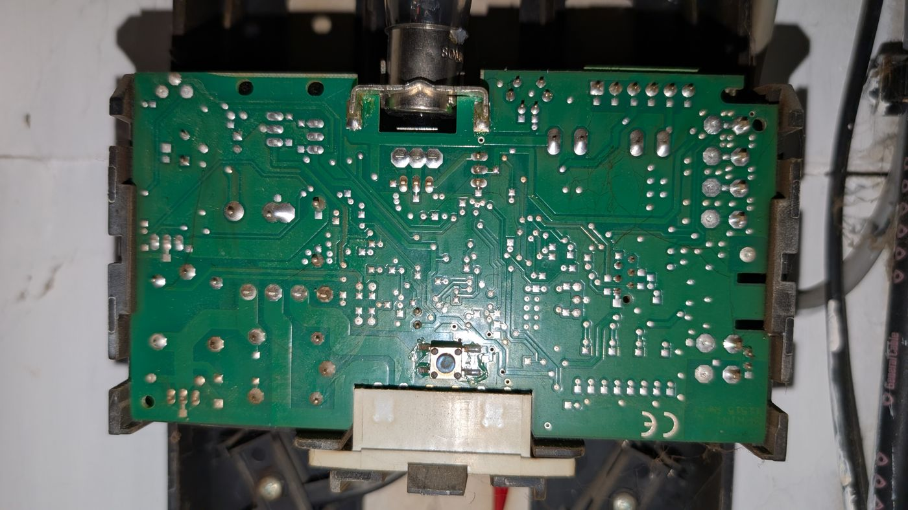
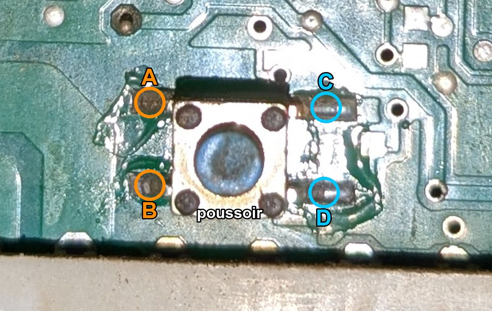

# 3. The control unit board and its manual switch

[Version française](../03-carte-moteur-et-bouton.md)

> **Danger.** The control unit contains **230 V** (transformer lugs, mains part of the board). **Switch off the power** (circuit breaker) before opening the unit and for any soldering. Only the two legs of the micro-switch are to be touched: they are low voltage.

## The housing

The control unit, fixed to the wall, is made by **Sectio-Tech** (the motor itself is on the door). Its cover carries the large red **manual switch**, the **lighting lamp** (in a slot at the top) and small adjustment buttons (Time, Reset, Radio).

With the cover removed: the electronic board is at the top, the **transformer** at the bottom.

## The electronic board

The board is marked **SPRINT IV** with reference **11515 Rev K**. No manual was found: everything comes from measurements.

The large manual switch **presses a micro-switch** mounted on the board. Here is this micro-switch seen from the solder side:

## Finding the two right legs

A micro-switch has 4 legs, connected two by two. The **pair that closes when pressed** must be found.

1. **Power off**, multimeter in **continuity** mode (beep).
2. Touch two legs with the probes and press the button with an insulated screwdriver or a finger from the cover side (board removed if needed).
3. Note the two legs that **beep only while the button is pressed**.

On this board they are **C** and **D**. These are the two legs to double with the relay.

## Voltage measurement at rest

**Power back on, with great care** (only the two multimeter probes are placed on the two legs, without pressing):

- Measured value: **4.98 V DC** between C and D at rest.

Interpretation: one leg is at about 5 V (pull-up resistor), the other is at board ground. A press connects the two. This is a **low-voltage button input**.

The relay's **dry contact** (10 A / 30 V DC) is more than adequate: it simply closes C and D, like the button.

Then switch the power off again.

## Do not

- **Never connect the ESP32 ground to the control unit board ground**: the isolation of this board from the mains is unknown. The relay is an isolated dry contact: no ESP32 wire is connected to the board.
- **Do not bypass the safety photocell** of the motorisation.
- Do not solder on legs A and B: they are not part of the button.

Then go to [guide 4](04-esp32-wiring.md) to wire the ESP32 and the relay **before** soldering anything on the board.
