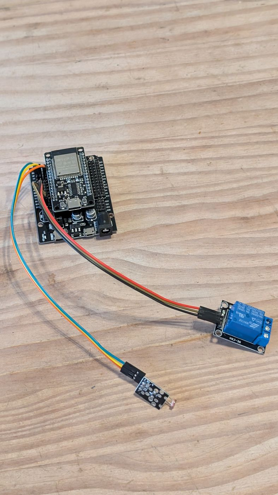
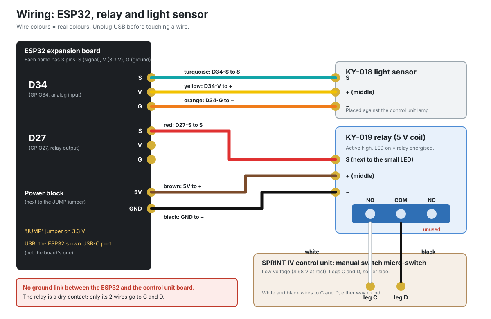
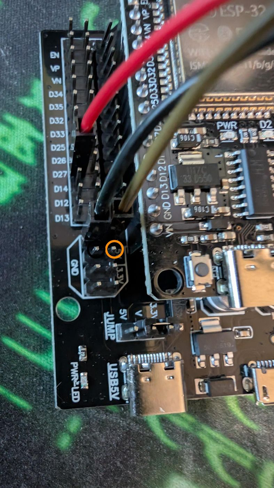
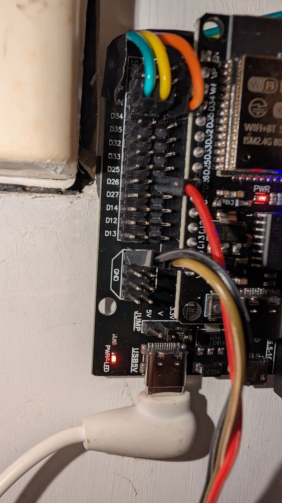
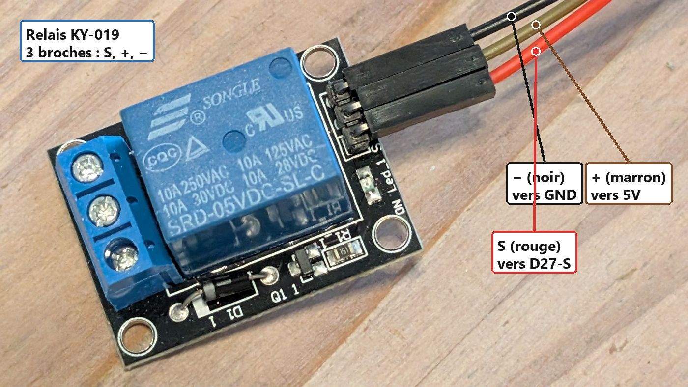
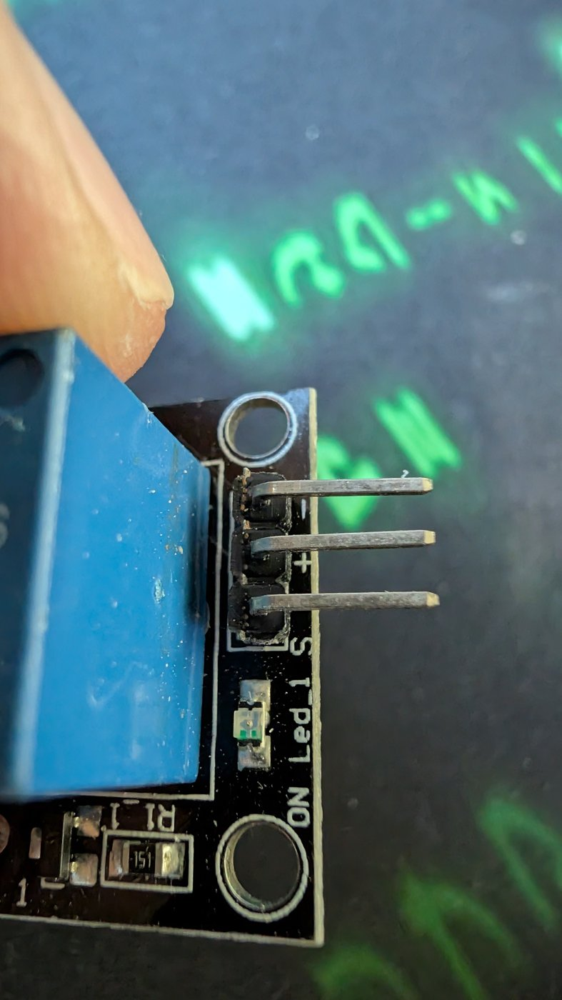

# 4. ESP32 wiring

[Version française](../04-branchements-esp32.md)

The assembly is first built **away from the installation** (as a bench test), without touching the motorisation. The relay, its "free" contacts and the sensor can be tested perfectly well on their own.

Quick reference: [wiring reference](00-wiring-reference.md) (wire colours).

Unplug the ESP32 from USB **every time a wire is moved**.

## Wiring table

| Module | Module pin | Goes to the ESP32 board |
|---|---|---|
| **KY-019 relay** | **S** (signal) | column **D27**, row **S** |
| KY-019 relay | **+** (middle) | 5V / GND block (next to the JUMP jumper), **5V** pin |
| KY-019 relay | **−** | 5V / GND block (next to the JUMP jumper), **GND** pin |
| **KY-018 sensor** | **S** | column **D34**, row **S** |
| KY-018 sensor | **+** (middle) | column **D34**, row **V** (3.3 V) |
| KY-018 sensor | **−** | column **D34**, row **G** |

## How to read the board

Each ESP32 pin (D27, D34, ...) has **3 pins in a line** on the board:

- **S**: the signal, **on the side of the printed name**;
- **V**: the middle, the voltage chosen by the jumper (3.3 V here);
- **G**: ground.

The name ("D27", "D34"...) is printed **next to** the row. Take care not to mix up the rows: D26 and D14 are next to D27, VN is just above D34.

On this photo: **orange circle = 5V** (brown relay wire), **black circle = GND** (black relay wire).

The real assembly, seen from the front:

## Why the relay is on 5 V and not 3.3 V

The relay coil is designed for **5 V**. The command signal (S pin) can come from the ESP32's 3.3 V: this is enough for the module's transistor. But the **power supply** (+) must be 5 V. The board jumper stays on 3.3 V for the sensor, and the **5V / GND block** powers the relay.

## Identifying the relay pins

On the relay board: **S** is the pin **next to the small LED** (`Led_1`), **+** is the **middle** pin, **−** is the pin **opposite the LED**. Always check against the symbols printed on the board.

## Tests before continuing

With the program from [guide 6](06-programming-the-esp32.md) installed:

1. **Sensor**: Settings page, "Live measurement" line. Pass a hand in front of the sensor, then shine a phone torch on it: the number must change strongly.
2. **Relay**: app **Open** button (outside simulation mode): a **click** is audible and the **relay LED** lights for about a second.

If the relay does not react, see [troubleshooting](12-troubleshooting.md).
