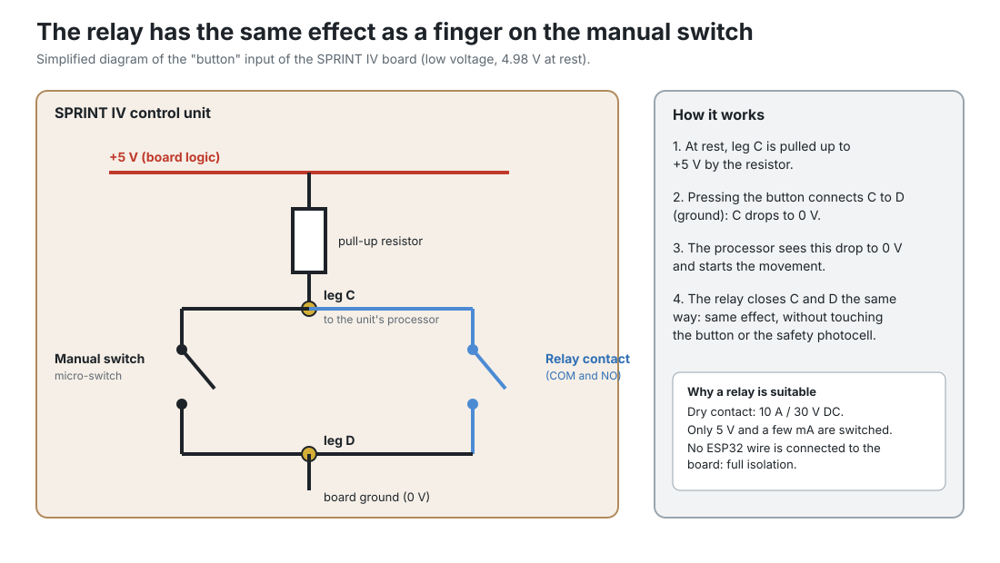
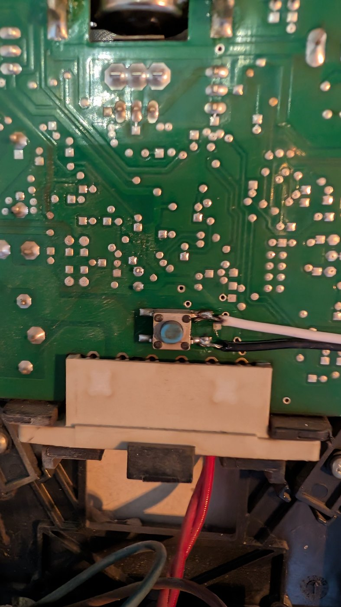
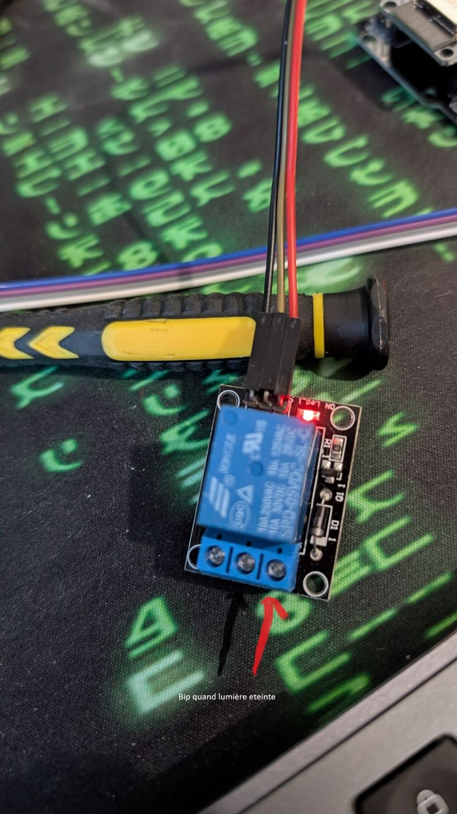
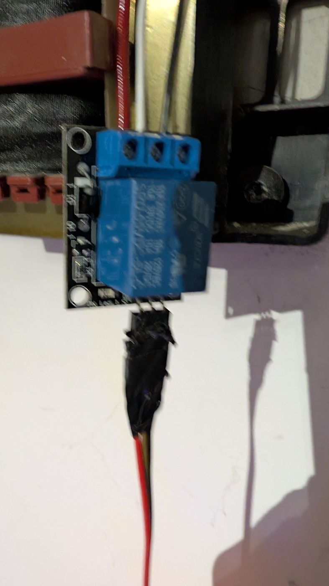

# 5. Soldering the relay to the button

[Version française](../05-souder-le-relais.md)

> **Power off at the circuit breaker** for this whole step. Check with the multimeter or a lamp that the motorisation is no longer powered before touching the board.

## Principle

The two relay contacts (**COM** and **NO**) are connected to the two legs **C** and **D** of the micro-switch (guide 3). The direction does not matter: COM can go to C or to D.

Result on the control unit board: **white** wire on the upper right leg, **black** wire on the lower right leg of the micro-switch (the two left legs, A and B, are not touched).

## Equipment

- 2 thin insulated wires (about 0.5 mm²), about 30 cm long.
- Fine soldering iron, solder, pliers.
- Electrical tape or sleeving for insulation.

## Steps

1. **Strip** 3 mm at the end of each wire and lightly **tin** it.
2. **Solder** one wire to leg **C** and the other to leg **D** of the micro-switch, on the **solder side** of the board. Work quickly (2 to 3 seconds per leg) and avoid touching neighbouring tracks.
3. Apply a **drop of glue or a turn of tape** to each wire close to the solder joint: pulling on the wire must not tear the leg off.
4. **Strip** the other end of each wire (5 mm) and pass it under a **screw of the relay terminal**:
   - one wire under **COM** (middle screw),
   - the other under **NO** (left screw on the photo of guide 2).
   Do **not** use NC.
5. **Tighten** the screws and pull gently on each wire to check it holds.

Pinching a Dupont pin in the screw terminal is not recommended: the contact is unreliable and can loosen with the vibrations of the door. Use a stripped wire.

## Multimeter check (power still off)

1. Multimeter in **continuity** mode.
2. Place the two probes on the **two screws COM and NO** of the relay terminal.
3. **Press the manual switch** of the control unit: the multimeter must **beep** while pressed and be silent when released.

This test proves that the wires soldered on C and D really reach the relay screws.

## First test with the motorisation

1. Power the ESP32, **simulation mode off**.
2. Switch the motorisation power back on.
3. Clear the door area (people, car, objects): **the door will move**.
4. Press **Open** in the app: the relay clicks and the door starts.
5. Check that the **original manual switch** still works, and the **original remote** too.
6. Check that the door **stops on an obstacle** (safety photocell), as before.

Next: [manual movement detector](09-manual-movement-detector.md) and [installation in the unit](10-installation.md).
