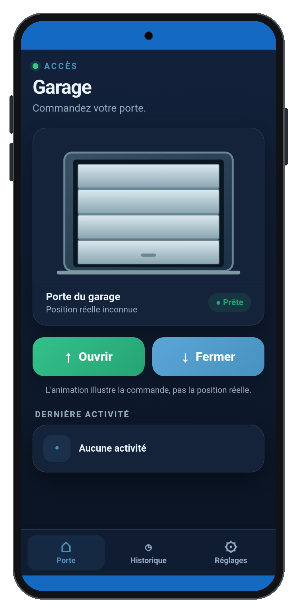
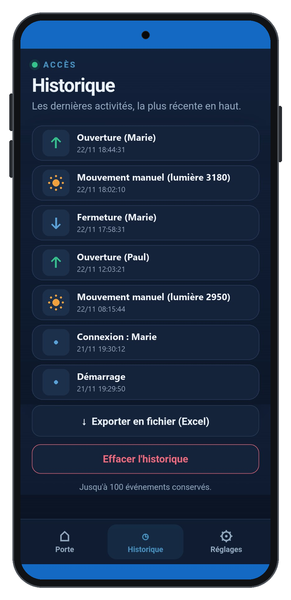
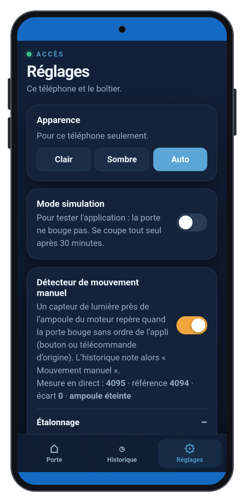
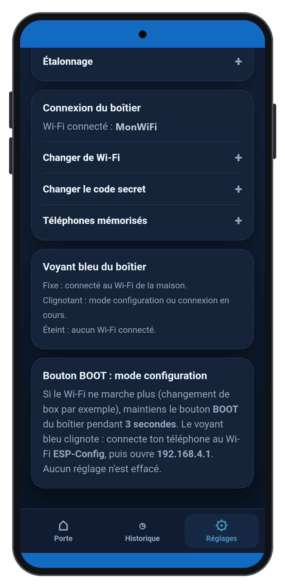

# 7. First start and use

[Version française](../07-premier-demarrage-et-utilisation.md)

> The app screenshots in this guide show the interface in French (the interface of the ESP32 program is in French).

## First start: the setup Wi-Fi

A new ESP32 (or after a long press on BOOT) opens its own open Wi-Fi network named **`ESP-Config`**:

1. On the phone, connect to **`ESP-Config`**.
2. Open **`http://192.168.4.1`**. The phone's system tries to open the configuration page by itself (captive portal) by querying a test address: `generate_204` on Android, `hotspot-detect.html` on iOS, `connecttest.txt` on Windows. The ESP32 answers these three requests. If the window does not open (private DNS enabled, mobile data taking priority, or a system version that does not show it), type the address by hand in the browser.
3. Fill in:
   - the **home Wi-Fi name**: typed, or chosen from the network search. A **hidden** network is typed by hand;
   - its **password**;
   - a **secret code** of **at least 6 characters**. If a code already exists, it must be typed again to confirm.
4. Save: the ESP32 restarts and connects to the home Wi-Fi.

The visible network names are **deliberately neutral** (`ESP-Config`, `esp-acces`): they mention neither "door" nor "garage".

## The indicator (blue LED of the board)

| LED | Meaning |
|---|---|
| **Steady** | Connected to the home Wi-Fi |
| **Blinking** | Configuration mode, or connecting |
| **Off** | No Wi-Fi connected |

## BOOT button: back to configuration mode

If the Wi-Fi no longer works (box change, for example), **hold the BOOT button for 3 seconds**. The LED blinks: connect to the `ESP-Config` Wi-Fi and open `192.168.4.1`. **No setting is erased.**

## Finding the ESP32 on the network

- Name: **`http://esp-acces.local`** (depending on the phone's system).
- Or its **IP address**. Recommended: create a **DHCP reservation** in the router so the address no longer changes.

## Logging in from a phone

1. Open the address in the phone's browser.
2. Enter the **secret code** and a **first name**. The first name will appear in the history.
3. The phone is **remembered** by a secure cookie valid for one year. **8 phones** at most.

A cookie belongs to one address: when using both `http://esp-acces.local` **and** the HTTPS address of guide 8, the phone must log in once on each.

## The screens

- **Door**: animated drawing of the door, **Open** (green) and **Close** (blue) buttons, last activity. The displayed state is **deduced from the last request** (there is no position sensor). Both buttons send the **same pulse**; the motorisation decides the direction. When the same command is repeated, the app warns and offers **Force**.
- **History**: 100 scrolling events (who, what, when), **CSV file export**, **Clear history** button with confirmation.
- **Settings**: light, dark or automatic theme; **simulation mode**; manual movement detector; Wi-Fi; secret code change; remembered phones; LED legend; BOOT button explanation.

### Door screen

The animation illustrates the command sent, not the real position. The "Prête" (ready) badge indicates that the ESP32 accepts a command.

### History screen

Each line shows the event, the person concerned and the timestamp. Event types: **Ouverture** (opening) and **Fermeture** (closing) (command given from the app, with the first name, "simulation" suffix in simulation mode), **Mouvement manuel (lumière N)** (manual movement: manual switch or original remote, detected by the light sensor; N is the measured gap, out of 4095, between the reference light and the light read at detection), **Connexion** (new phone), **Mot de passe faux n/5** (wrong password), **Démarrage** (start) and **Historique effacé** (history cleared). The names and dates in the capture are examples.

### Settings screen

## Simulation mode

In **Settings**, the "Simulation mode" switch makes **commands recorded but the relay does not click**. An orange banner appears on every page. It is kept in RAM only: it **switches off by itself after 30 minutes** and at every restart. To be used to test the app without moving the door.

## Installing the app on the home screen

- **Android (Chrome)**: installation requires an **HTTPS** address: see [guide 8](08-https-home-network.md). Without HTTPS, only adding a shortcut is possible.
- **iPhone (Safari)**: open the address, tap **Share**, **Add to Home Screen**, **Add**, then open the app from its icon.

## Limits of the app

- The "open / closed" state is an **assumption** (last request), not reality.
- HTTP is **not encrypted** on the home network. See [Security and limits](11-security-and-limits.md).
