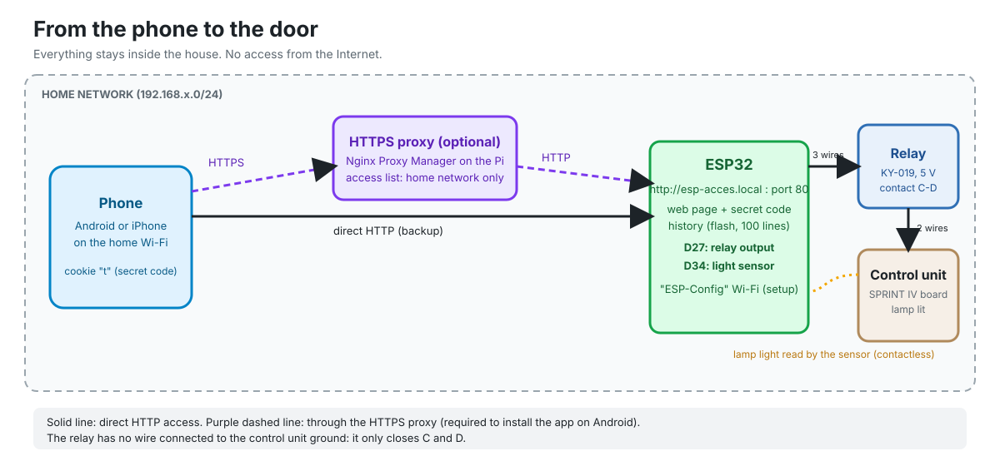

# 8. HTTPS address, restricted to the home network

[Version française](../08-https-reseau-maison.md)

The ESP32 speaks plain HTTP. To **install the app as a real application** on Android (and get the padlock), an **HTTPS** address is needed. A "reverse proxy" is therefore added on a small home server (here a Raspberry Pi with Docker). **This guide is optional.**

## Principle

- A free name from **DuckDNS** (for example `acces.example.duckdns.org`) points to the router's public address.
- The router forwards port **443** to the Raspberry Pi.
- **Nginx Proxy Manager** (NPM) on the Pi receives the request, presents a valid **Let's Encrypt** certificate, then forwards it to the ESP32 as `http://<esp32-ip>:80`.
- An **access list** in NPM only allows the home network (`192.168.x.0/24`) and refuses everything else.

## Steps

1. **DuckDNS**: create a sub-domain and keep the public IP up to date (script or scheduled task).
2. **NPM**: install it with Docker. If ports 80 and 443 of the Pi are already taken, use for example 18080 (HTTP), 18081 (administration) and 18443 (HTTPS), then forward the **router's 443** to the Pi's **18443**.
3. **Access list**: create a "garage_door" list: *Allow* `192.168.1.0/24` (adapt to the local network), then *Deny all*.
4. **Proxy host**: domain `acces.example.duckdns.org` → `http://<esp32-ip>:80`. SSL tab: request a Let's Encrypt certificate, enable "Force SSL". Main tab: choose the access list.
5. **Local resolution**: at home, the phone must reach the Pi when it asks for this name. Many routers handle the loop-back badly ("hairpin NAT"): the simplest is to declare this name in the local DNS (Pi-hole, AdGuard, or the router if it allows it) pointing to the Pi's IP.

## Never remove

The **access list**: the goal is that the app is **not reachable from the Internet**. The Let's Encrypt certificate is valid, but only the home network can use the door.

## Checking

- **Inside the house** (Wi-Fi): `https://acces.example.duckdns.org` must show the page with a padlock.
- **Outside the house** (4G, Wi-Fi off): the address must answer **403 Forbidden**. If the login page appears, the access list is misconfigured: fix it immediately.

## Installing the app on Android

Open the HTTPS address in Chrome, ⋮ menu, **Install app**. The icon appears with the name "Accès". The `manifest.json` file and the 192/512 icons are served by the ESP32.

## Limit

Traffic between the Pi and the ESP32 stays in HTTP on the local network. See [security](11-security-and-limits.md).
