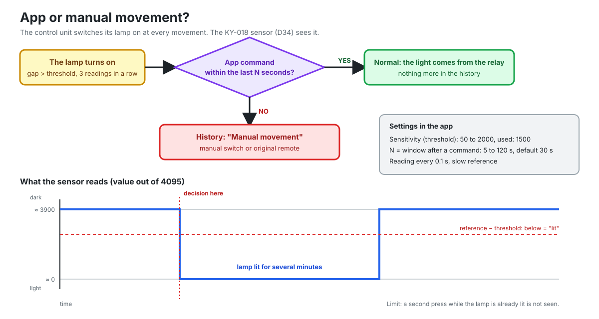
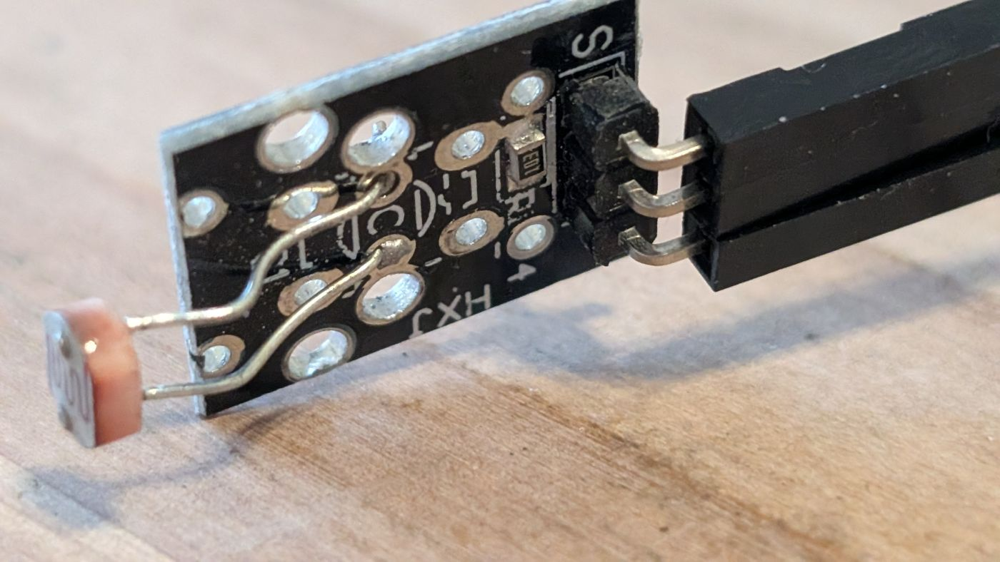
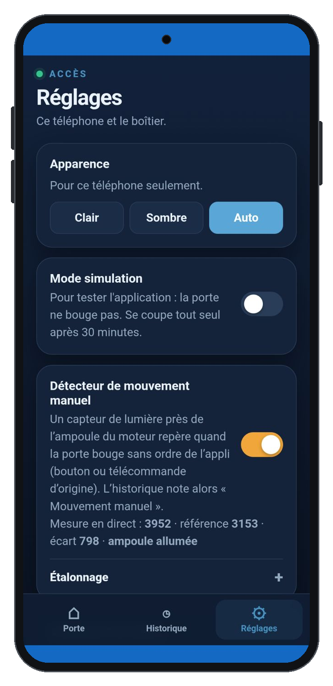
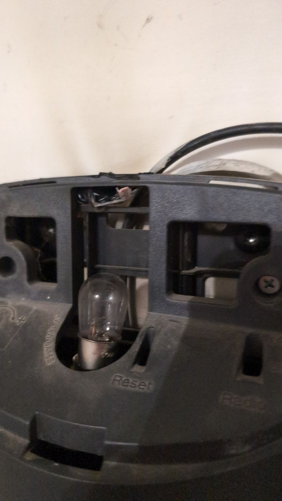

# 9. Manual movement detector (light)

[Version française](../09-detecteur-mouvement-manuel.md)

## The problem

When someone presses the **real manual switch** or the **original remote**, the ESP32 knows nothing about it: the relay is not touched. The app history would therefore miss door movements.

No wire is attached to the control unit board (isolation from the mains not verified). Contactless solution: the unit **switches its lamp on** at every movement (for several minutes). A light sensor placed against the lamp sees it turn on.

## The sensor

**KY-018** module (photoresistor): 3 pins S, +, −. The more light, the **lower** the value read (lamp against the sensor: close to 0; darkness: 3150 to 3950 out of 4095).

Wiring: see [guide 4](04-esp32-wiring.md) (D34: S, V, G). **D34** is an ADC1 input, usable with Wi-Fi on.

## Program principle

1. Reading **every 0.1 s**.
2. A **slow reference value** (moving average) follows the ambient light: day, night, clouds.
3. The light is "on" if the gap with the reference exceeds the **threshold** **3 times in a row** (filter against noise).
4. At turn-on, the program checks whether an **app command** was given in the **previous N seconds** (window, 30 s by default). If so: it is the relay, nothing to record. Otherwise: a **"Mouvement manuel (lumière N)"** line is written in the history, where **N is the measured gap** (reference minus value read, out of 4095): a value close to the threshold indicates a borderline detection, a much higher value a clear detection.
5. If the light stays wrong for 10 minutes (slow change, shadow), the reference is taken again.

The app state is also updated: if the door moves without a request, the app no longer shows a stale state.

## Settings in the app

**Settings** page, "Manual movement detector" block:

| Setting | Role | Tested value |
|---|---|---|
| Enabled | Detector on / off | yes |
| **Sensitivity (threshold)** | Gap to exceed, from 50 to 2000. Smaller = more sensitive. | 1500 (default 400) |
| **Window after a command** | Seconds during which a turn-on is attributed to the app, from 5 to 120. | 30 s |

The **live measurement** (value, reference, gap) allows calibrating the detector: the following table helps.

| Observation | Action |
|---|---|
| The gap never reaches the threshold when the lamp turns on | Lower the threshold |
| "Movements" appear for no reason | Raise the threshold |
| An app command is recorded as manual | Increase the window |
| A manual movement follows a command but is attributed to the app | Reduce the window |

## Placement

- Place the sensor **against the lamp** (the slot of the cover) so that the garage light does not interfere.
- **The lamp gets hot** (18 W incandescent lamp, BA15S base): do not touch the glass with the sensor or the wires. Ordinary adhesive tape is not designed for heat: use a spacer or heat-resistant tape.
- Calibration must be done **once installed**: on the desk, the values are not representative.

## Limits

- A **second press** while the lamp is **already on** is **not seen**.
- Daylight entering the unit can reduce the contrast: adjust the threshold accordingly.
- The detection does **not** indicate the **direction** of the movement (opening or closing).
