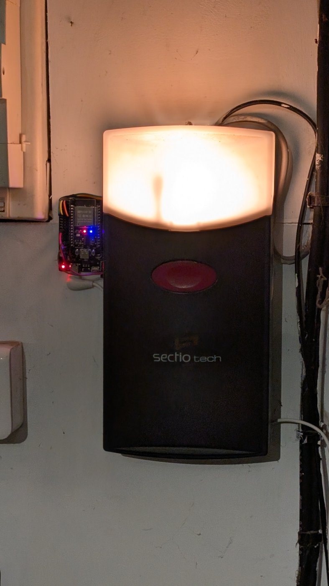
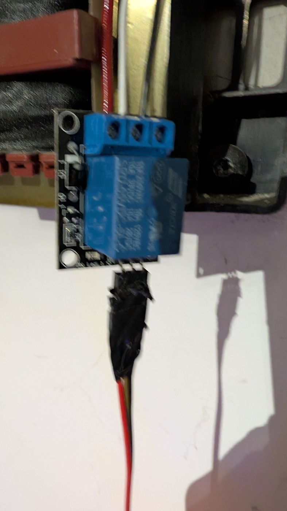

# 10. Installation at the control unit

[Version française](../10-installation-dans-le-boitier.md)

## Layout

The relay and the sensor are inside the control unit; the ESP32 and its board are fixed **to the wall, next to the unit** (photo below, at night: the control unit lamp is on). The wires enter the unit from the top.

## Power supply

A supply **taken from the control unit board** (low-voltage output) was considered, then ruled out.

- The board has no manual: the real voltage and the isolation from the mains are unknown.
- An ESP32 plus a relay draw 100 to 250 mA: this could disturb the motorisation.
- **Solution chosen**: an ordinary USB charger (5 V, 1 A or more) on a 230 V socket, with a cable passed through the cover, **outside the 230 V area** of the control unit.

**Never** connect the ESP32 ground to the control unit board ground.

## What goes where

- **Relay**: fixed inside the unit, the two wires to C and D kept short.
- **ESP32 + board**: fixed to the wall against the unit, **outside the transformer area**, with wires as short as possible; powered by a white USB cable to a charger.
- **Sensor**: against the lamp (guide 9).

The double-sided tape used is **not conductive**, which avoids a short circuit between pins; a multimeter check is still recommended.

## Securing the Dupont wires

Dupont pins loosen with the vibrations of the door.

1. Connect all the wires.
2. Add turns of **electrical tape** around each connector and the board (heat-shrink sleeving does not help on female pins).
3. Do a **light pull test** on each wire.
4. For a permanent assembly: solder the wires on a perforated board or use screw terminals.

After any wire has been moved, repeat the relay test (click) and check the sensor reading.

## Final check

1. The app opens and closes the door.
2. The manual switch and the original remote work.
3. The safety photocell still stops the door.
4. The light detector records a press on the manual switch.
5. After a power cut, the ESP32 restarts by itself, **relay at rest**.
6. Nothing is burning hot or badly fixed; the wires touch neither the lamp nor the transformer.
