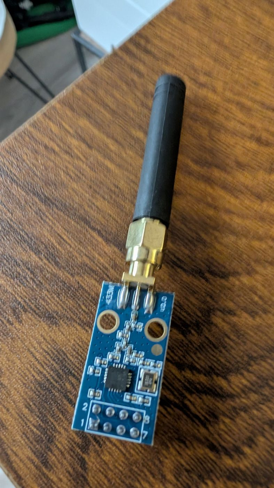
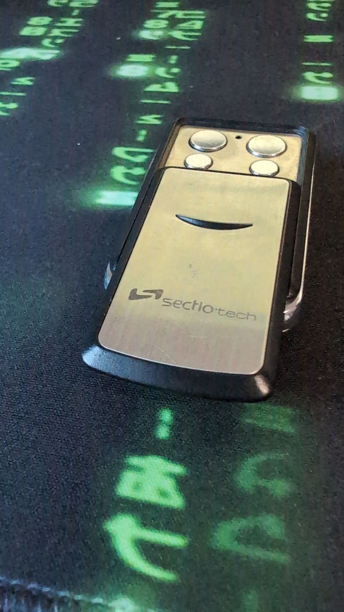
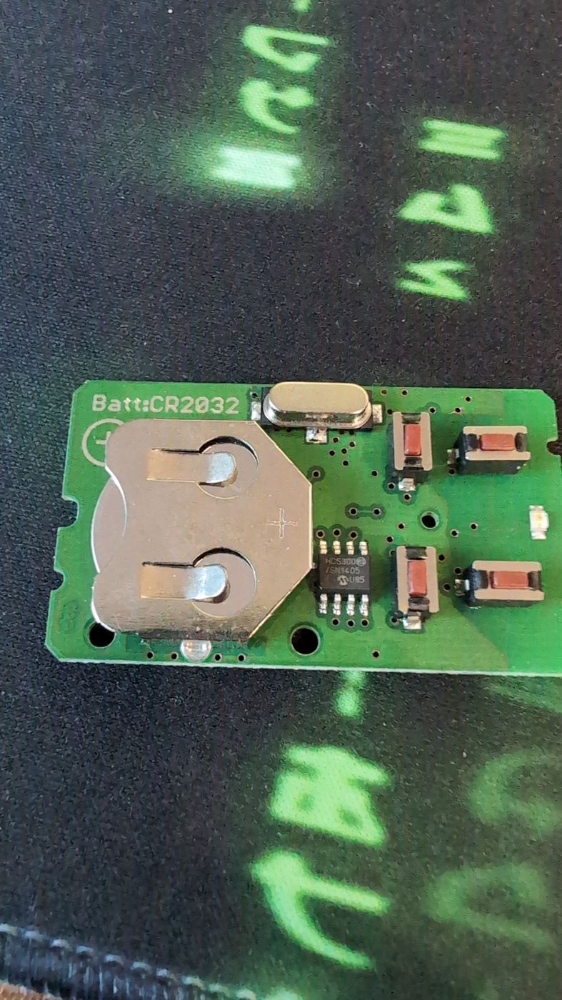

# 13. Project history

[Version française](../13-histoire-du-projet.md)

Why the assembly is the way it is, and what was tried before.

## 1. The idea

Open and close a garage door from a smartphone **when arriving by car**, over the home Wi-Fi. No Bluetooth. No direct access from the Internet. One person has an Android, the other an iPhone with wired CarPlay.

## 2. First lead: copy the radio remote

First approach: **copy the original remote** with a radio module. This approach was tested then dropped: the remote (Sectio-Tech) contains an **HCS300** chip, with **rolling code (KeeLoq)**. Each press sends a different code, impossible to replay without the manufacturer's key. A **CC1101** radio module was wired and validated (version 0x14), but copying is **not possible**. The idea was abandoned, and this is what led to the relay.

**Checkpoint**: before buying a radio module, read the reference of the remote's chip. An HCS200, HCS300, HCS301 or any KeeLoq chip indicates a rolling code: radio copy is ruled out.

Watch point: **never swap VCC and GND on a CC1101** (overheating), and identify the wires by **pin number**, not by colour.

## 3. The solution: a relay in parallel with the manual switch

The control unit has a **large red manual switch** that presses a micro-switch. A relay whose contacts are wired **in parallel** with this micro-switch does the same as a finger, without touching the safety circuits. Legs C and D were identified with the multimeter (4.98 V DC at rest: low-voltage input).

## 4. The application in the ESP32

The first versions used the `WebServer` web server, with a **sometimes very long delay** on the relay. Migration to **`esp_http_server`**: delay gone. The interface is first drawn in a **demo page** (`docs/demo/demo.html`, example data) before being ported into the program. The page is gzip-compressed and takes about 10 KB.

- Login with secret code + first name, secure cookie.
- History of 100 events in flash.
- Simulation mode.
- Wi-Fi configuration through the `ESP-Config` captive portal.
- OTA update.

## 5. HTTPS restricted to the home network

To install the app on Android, HTTPS is needed: a Nginx Proxy Manager proxy on a Raspberry Pi, Let's Encrypt certificate, **access list** limited to the home network.

## 6. Detecting manual movements

Since the manual switch cannot be "listened to" without isolation risk, the choice was: a **photoresistor against the control unit lamp**. Several problems were met:

- Reference stuck after a light step: **reference reset after 10 minutes** added.
- Default threshold too sensitive in real conditions: settings in the app (sensitivity 1500).
- Limit: second press while the lamp is on.

## 7. Failures and lessons

- Limit of **20 HTTP routes**: the 21st was silently ignored. Raised to 32.
- A **relay signal wire on the wrong row**: no more click. Always identify D27 by its printed name.
- A relay powered at **3.3 V** does not energise: it needs **5 V**.
- **Power taken from the control unit board**: refused (no manual, isolation unknown).

## 8. Ideas for later

- Phone **notifications** (Web Push).
- **Infrared position sensor** to know the true state of the door.
- Detect the **real manual switch** with an isolated circuit (PC817 optocoupler + 2N7000 MOSFET on C and D, never connecting the grounds).
- Time on the "Démarrage" line.
- Shared dashboard (Home Assistant).
